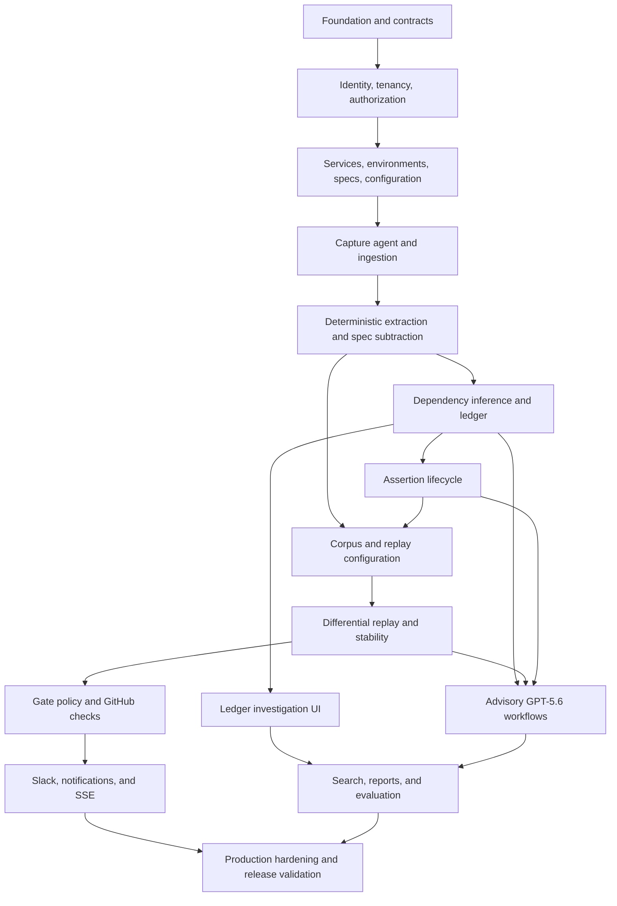

# Hyrum End-to-End Development Plan

**Status:** Recommended implementation order  
**Sources:** [`PRD.md`](./PRD.md), [`TECH_STACK.md`](./TECH_STACK.md),
[`SCHEMA.md`](./SCHEMA.md), and the existing project scaffold  
**Constraint:** This plan defines dependency order and validation gates; it intentionally contains no
timelines, sprint assignments, or effort estimates.

## 1. Product understanding and implementation objective

Hyrum is a developer tool for B2B platform/API teams that discovers undocumented observable API
behaviors and determines which external consumers may rely on them. It converts session-correlated,
capture-side-redacted production traffic into an evidence-backed ledger, then measures proposed API
changes through differential replay in CI. The product exists to answer two questions with receipts:

1. What accidental contracts have consumers come to rely on?
2. Which consumers will a candidate build affect, and should the pull request block, warn, or pass?

The source of truth is deterministic code. The Go capture and replay paths import the same versioned
extractor package. GPT-5.6 can name, cluster, rank, explain, and draft, but its schema-validated output
is advisory. A stable replay delta matched to T1 echo evidence may block; T2 pattern evidence warns;
T3 exposure is informational and is never called a proven dependency in the UI.

Primary users are platform/API team leads and API engineers. API support/DX engineers and SREs use
the ledger and replay results to understand blast radius. Organizations with external consumers,
gateway/log access, and containerizable API builds are the initial customer profile.

The production architecture has two planes:

- A TypeScript control plane: Next.js web, Fastify API, Postgres-backed worker, WorkOS AuthKit,
  Drizzle/Postgres, R2 object storage, OpenAI, GitHub, Slack, and SSE.
- A Go data plane: customer-side capture/redaction/session processing and CI-side differential replay,
  sharing deterministic extractors and masks.

The completion objective is a real capture → extraction → spec subtraction → evidence tiering →
ledger → replay → policy decision → GitHub Check pipeline, with the demo's three scripted consumers
clearly identified as scripts. Broad simulated integrations must not replace this vertical slice.

## 2. Product roles, administration, and access boundaries

### 2.1 Organization roles

Hyrum requires four customer roles and does not require a customer-visible global super-admin:

- **Owner:** tenant lifecycle, ownership transfer, retention, membership, services, integrations,
  policies, evidence review, assertions, and organization deletion/export.
- **Admin:** organization configuration and member management except owner-only actions; manages
  services, agents, specs, integrations, policies, claims, assertions, and replays.
- **Engineer:** day-to-day platform user; reads evidence, runs replay, pins assertions, reviews claims,
  and uses configured integrations. Cannot change retention, roles, or default gate policy.
- **Viewer:** read-only access to ledger, consumers, endpoints, replay results, reports, and authorized
  redacted receipts.

API support/DX and SRE are usage personas, not separate permission roles in v1. They normally receive
`viewer` or `engineer` based on whether they need to act. Avoid creating role proliferation until a
real permission distinction appears.

### 2.2 Internal operations

Production needs a narrowly scoped internal **platform operator**, not a normal super-admin. Platform
operators can inspect service health and perform audited break-glass support only through a
time-bounded `support_access_grants` record. They have no implicit tenant-data visibility, cannot
silently impersonate users, and cannot alter deterministic evidence or gate decisions. Sensitive
support access should require a second operator's approval.

### 2.3 Machine principals

- Capture agents receive scoped, revocable first-party credentials restricted to ingestion/config
  retrieval for one tenant and agent.
- CI runners exchange GitHub/OIDC context or one-use tokens for corpus download and report upload.
- GitHub installation tokens are requested just in time and never persisted.
- Workers use an internal service identity and still set explicit organization context per job.
- Slack and webhook identities are verified by provider signatures, not browser sessions.

### 2.4 Permission enforcement pattern

Every request follows: authenticate principal → resolve organization → load active membership or
machine credential → authorize explicit action → set tenant database context → execute tenant-scoped
repository → audit sensitive operation. UI visibility is convenience only; the API is authoritative.
Postgres RLS and composite tenant foreign keys contain defects but do not replace service-layer checks.

## 3. Recommended build sequence



The first feature module is identity/tenancy/authorization because every control-plane boundary
depends on trustworthy organization context. The first product-domain module is service/spec
configuration because capture, operations, behaviors, and replay all need a stable API identity.
Backend contracts and deterministic fixtures precede feature UI; frontend work starts once each
module's API schemas, authorization, and persistence semantics are stable.

Work that can proceed independently after shared contracts exist:

- The demo API/consumer fixtures and the shared Go extractor test vectors can proceed alongside human
  authentication.
- The design-system shell and reusable data-state components can proceed alongside database work.
- GitHub App manifest setup and Slack app setup can proceed alongside core domain work, but webhook
  state changes wait for tenant repositories and idempotency storage.
- Prompt/schema development can proceed against frozen redacted fixtures, but no AI workflow ships
  before deterministic validators and eval gates exist.
- Infrastructure configuration can proceed continuously, but hosted arbitrary replay is explicitly
  out of scope; replay stays in CI.

### 3.1 Requirement coverage map

| PRD/architecture requirement                                                     | Owning stages | Primary schema records                                                             |
| -------------------------------------------------------------------------------- | ------------- | ---------------------------------------------------------------------------------- |
| Organization identity, roles, invitations, and tenant isolation                  | 1, 14         | `organizations`, `memberships`, `invitations`, audit/access tables                 |
| Monitored services, immutable OpenAPI versions, and normalized operations        | 2, 4          | `api_services`, `api_specs`, `api_operations`, `api_spec_operations`               |
| Session-correlated sampling with low-volume boost and capture-side redaction     | 3             | agents, versioned policies/keys, consumers/identifiers, batches, sessions, objects |
| Shape, ordering, and error-template extraction; timing excluded                  | 4             | behavior definitions/observations and extractor releases                           |
| Spec subtraction of declared behavior                                            | 4             | `behavior_spec_classifications`                                                    |
| T1 echo proof, T2 pattern evidence, and T3 exposure                              | 5             | claims, claim evidence, receipts, ledger entries                                   |
| Per-consumer ledger and evidence investigation                                   | 6             | ledger/behavior/consumer/search records                                            |
| Expiring assertions and document/extend/deliberately-break resolution            | 7             | assertions/events, break plans/impacts, exact gate exceptions, drafts              |
| Coverage-curated immutable replay corpus and safe fixtures/stubs                 | 8             | corpora/items, replay/mask profiles, stored objects                                |
| Base/candidate differential replay, masking, repeated stability, quarantine      | 9             | replay runs/attempts/deltas and signed runner sessions                             |
| T1 block, T2 warn, T3 note/pass and GitHub Check delivery                        | 10            | policies, decisions/impacts, repository mappings, checks/webhooks                  |
| GPT-5.6 advisory naming, clustering, tier proposals, explanations, and drafts    | 11            | prompt/model provenance, labels/clusters, citations, drafts, evals                 |
| Slack/in-app notifications and one-way live progress                             | 12            | notification routes/preferences/deliveries and outbox/jobs                         |
| Precision plus recall, replay stability, freshness, and time-to-ledger reporting | 13            | evaluation datasets/runs/metrics and usage rollups                                 |
| Retention, privacy deletion/export, key rotation, support access, and audit      | 14            | objects, key versions, subject requests, tenant/platform audit records             |
| Real hackathon vertical slice with three explicitly scripted consumers           | 15            | all domain records populated through the real pipeline                             |

The non-goals remain enforced: Hyrum does not proxy/modify production responses, does not become an
observability or error-tracking product, excludes timing behavior, does not target internal-only meshes
in v1, and does not host arbitrary customer images. Native gateway adapters, generalized write-path
replay, controlled canary variation, billing, SCIM, and additional stateful infrastructure remain
deferred until the approved architecture changes.

## 4. Stage 0 — Foundation alignment and domain contracts

1. **Purpose:** Turn the existing production-grade scaffold into the stable contract layer used by all
   features while preserving its architecture.
2. **Users/roles:** Developers and platform operators; no customer-facing behavior beyond existing
   health/auth shells.
3. **Capabilities:** Canonical IDs, enums, event envelopes, RFC 9457 errors, cursor pagination,
   organization context, object references, job payload registration, OpenAPI generation, and shared
   Go/TypeScript fixture formats. Make verification inputs deterministic by excluding generated
   `.turbo`, `.next`, `dist`, coverage, and test-report artifacts from formatter/linter discovery.
4. **Frontend:** Retain the App Router shell, providers, shadcn primitives, semantic tokens, route-level
   loading/error/not-found states, and public sign-in page. Add reusable app-shell primitives without
   feature pages.
5. **Backend:** Split Fastify plugins into auth, tenant context, authorization, database transaction,
   object storage, audit, idempotency, and OpenAPI modules. Define request/response schemas in
   `packages/contracts`; generate the typed API client.
6. **Schema entities:** Existing foundational `organizations`, `users`, `memberships`, `jobs`,
   `outbox_events`, and `audit_events`; no complete feature migration yet.
7. **Dependencies:** Current scaffold, approved environment variables, Postgres, MinIO, WorkOS dev
   project.
8. **Prerequisites:** PRD/stack guardrails encoded in repository documentation and CI; local services
   start reliably.
9. **Exit validation:** `pnpm verify`, Go tests/vet, clean database migration, OpenAPI generation,
   no-secret logging tests, API problem responses, and public/protected browser smoke tests all pass
   from both a clean checkout and a warm build cache.

Build early and reuse everywhere:

- `RequestContext` and `ActorContext` with explicit `organizationId`, membership/machine identity,
  role, permissions, request ID, and recent-auth timestamp.
- UUID, timestamp, cursor, digest, object reference, tier, status, and pagination schemas.
- Tenant-aware repository base helpers that cannot query without an organization ID.
- RFC 9457 error catalog with stable error codes and field-error details.
- Idempotency helper, raw-body webhook verifier, audit writer, transactional outbox writer, and job
  registry.
- Typed object-storage service that validates tenant prefix, digest, purpose, expiry, and signed-URL
  scope.
- UI `AppShell`, organization/service selectors, `PageHeader`, filters, tables, status/tier badges,
  empty/loading/error states, confirmation dialogs, evidence drawer, semantic diff, code/JSON viewer,
  toast, and permission guard.

## 5. Stage 1 — Identity, organizations, authorization, and onboarding shell

1. **Purpose:** Establish trustworthy human identity, tenant selection, invitations, role boundaries,
   and resumable organization setup.
2. **Users/roles:** Owners create/manage the tenant; admins invite non-owner members; engineers/viewers
   accept invitations and select a workspace; platform operators use a separate internal surface.
3. **Capabilities:** WorkOS callback synchronization, organization membership reconciliation,
   invitation acceptance, organization switch, role checks, recent reauthentication, owner transfer,
   member suspension, and onboarding progress.
4. **Frontend:** `/app/select-organization`, `/app/onboarding`, `/app/settings/members`, invitation
   acceptance/error pages, account menu, organization switcher, permission-aware navigation, and a
   clear “no organization” recovery state. Owner-only destructive actions use typed confirmation and
   recent auth.
5. **Backend:** WorkOS webhook verification/idempotency, session-to-user mapping, organization and
   membership repositories, invitation APIs, authorization middleware, role/permission matrix, and
   audit events. Never trust organization ID from a browser without membership resolution.
6. **Schema entities:** `organizations`, `organization_settings`, `users`, `memberships`,
   `invitations`, `onboarding_progress`, `webhook_deliveries`, `audit_events`; internal tooling uses
   `platform_operators` and `support_access_grants` later.
7. **Dependencies:** Stage 0 auth/context/error/audit foundations and configured WorkOS AuthKit.
8. **Prerequisites:** Stable role matrix, identity webhook contract, local WorkOS test organization,
   and tenant-scoped repository helpers.
9. **Exit validation:** Cross-tenant access tests fail closed; each role sees and can execute only its
   permissions; duplicate/out-of-order WorkOS events converge; last-owner removal is rejected; mobile
   and keyboard onboarding flows pass Playwright; audit entries contain no tokens or session data.

## 6. Stage 2 — API services, environments, specifications, and policies

1. **Purpose:** Create the stable monitored-API identity and immutable configuration versions required
   by capture, subtraction, replay, and gates.
2. **Users/roles:** Owners/admins configure; engineers upload specs and inspect validation; viewers read.
3. **Capabilities:** Create a service/environment, upload or link an OpenAPI 3.x document, validate and
   normalize it, map stable operations, activate a spec, and define redaction, sampling, masking,
   replay, and gate-policy drafts.
4. **Frontend:** Guided `/app/onboarding/service`, service settings, environments, spec versions,
   validation results, operation catalog, redaction/sampling form, replay safety form, and policy
   preview. Use multi-step forms with saved progress and a final review screen.
5. **Backend:** CRUD for service/environment; secure multipart/presigned upload flow; Swagger Parser
   and Ajv validation with remote `$ref` disabled; canonical operation identity; immutable config
   version activation transactions; content-type/size/digest/malware verification and quarantine;
   outbox jobs for normalization.
6. **Schema entities:** `api_services`, `service_environments`, `api_specs`, `api_operations`,
   `api_spec_operations`, `extractor_releases`, `redaction_policy_versions`,
   `sampling_policy_versions`, `mask_profile_versions`, `replay_profiles`, `gate_policies`,
   `gate_policy_versions`, `stored_objects`, `onboarding_progress`.
7. **Dependencies:** Identity and tenant authorization; object-storage and jobs/outbox foundations.
8. **Prerequisites:** Object key/TTL policy, spec size limits, SSRF threat model, normalized OpenAPI
   fixture format, and API-service ownership decisions.
9. **Exit validation:** Re-upload is idempotent; invalid specs show actionable errors; nullable,
   optional, and absent stay distinct; path templates are stable across versions; only one active
   version exists per scope; quarantined/unverified uploads cannot be parsed or downloaded;
   cross-tenant object/spec access is impossible; activation is audited.

Backend service/spec APIs must be complete before building their full forms. The forms depend on
server-returned validation errors, immutable version IDs, permission checks, and activation semantics.

## 7. Stage 3 — Demo system, capture agent, machine auth, and ingestion

1. **Purpose:** Produce trustworthy, sequence-preserving, capture-side-redacted input without affecting
   customer traffic.
2. **Users/roles:** Owners/admins install agents; engineers verify capture; the Go agent authenticates
   as a machine principal. Hackathon judges see the real demo path with explicitly scripted consumers.
3. **Capabilities:** Demo e-commerce API with eight endpoints, scripted consumers A/B/C, 50k NDJSON
   fixture, agent registration/token rotation, session-correlated sampling, low-volume boost, structural
   HMAC, rotation-safe consumer identity aliases, sensitive-field removal, batching, encrypted bounded
   spool, backoff, and idempotent ingestion.
4. **Frontend:** Agent installation instructions, one-time credential display, copy-safe config,
   connection health, last seen/version/config revision, ingestion counters, rejected-item diagnostics,
   and a live onboarding success state. Do not display raw traffic.
5. **Backend:** Machine credential issuance/revocation, config retrieval, batch ingestion with strict
   unknown-field rejection, per-item acceptance, content/digest validation, object upload, job enqueue,
   bounded rejection manifests, agent heartbeat, rate/body limits, and SSE progress events.
6. **Schema entities:** `agents`, `machine_credentials`, `ingestion_batches`, `consumers`,
   `consumer_identifiers`, `capture_sessions`, `organization_key_versions`, `stored_objects`,
   configuration-version tables, `jobs`, `outbox_events`, `audit_events`, `usage_rollups`.
7. **Dependencies:** Service/environment and active redaction/sampling/extractor versions; object
   storage; tenant-aware machine authentication.
8. **Prerequisites:** Language-neutral capture-envelope JSON schema; tenant-derived HMAC key delivery
   and bounded dual-alias rotation protocol; forbidden-header/path test corpus; explicit fail-open and
   spool limits; declared demo scripts.
9. **Exit validation:** Secrets, cookies, auth headers, multipart/binary bodies, configured paths, and
   adversarial values never cross the agent boundary; T1 sequences survive sampling; low-volume boost
   works; current/retiring HMAC aliases resolve to the same stable consumer without cross-tenant
   comparison; duplicate batches do not duplicate processing; per-item rejections are actionable but
   redacted; outages spool within bounds and never affect the proxied API; Go fuzz/race tests and
   ingestion load/backpressure tests pass.

## 8. Stage 4 — Deterministic extraction and OpenAPI subtraction

1. **Purpose:** Turn redacted sessions into reproducible shape, ordering, and error-template facts and
   identify which are undeclared.
2. **Users/roles:** All product users consume results; engineers/admins inspect extractor/config
   provenance. No human or model creates fingerprints.
3. **Capabilities:** Canonical JSON shape extraction, absent/null/type distinction, undocumented field
   detection, bounded enum-like values, pagination ordering analysis, error-template normalization,
   nondeterminism masking, content-addressed fingerprints, aggregate observations, and spec subtraction.
4. **Frontend:** Processing progress, operation coverage, extractor/config version labels, failed-batch
   diagnostics, and undeclared/declaration status. Full ledger UI waits for Stage 6.
5. **Backend:** Worker handlers invoke the pinned Go CLI/library; validate output schemas; upsert stable
   operations/behavior definitions; aggregate by endpoint × consumer × time bucket; classify against
   current spec; enqueue inference; remain idempotent under retries.
6. **Schema entities:** `api_operations`, `behavior_definitions`, `behavior_spec_classifications`,
   `behavior_observations`, `ingestion_batches`, `capture_sessions`, `extractor_releases`,
   `api_specs`, `jobs`, `outbox_events`.
7. **Dependencies:** Completed capture format and fixture corpus; immutable spec/config versions; shared
   Go extractor package.
8. **Prerequisites:** Golden canonicalization cases and behavior schema; explicit pagination context;
   high-cardinality caps; normalization rules; no timing fields.
9. **Exit validation:** Capture and replay produce byte-identical fingerprints for the same data;
   repeated processing is idempotent; golden/fuzz tests cover depth, invalid UTF-8, huge values,
   arrays, duplicate headers, timestamps, UUIDs, absent/null, and error templates; declared subtraction
   fixtures match OpenAPI semantics; no LLM is called in the fact path.

This deterministic core should be implemented before AI naming and before the main ledger UI. Its
identifiers and result semantics are the product contract the rest of the system presents.

## 9. Stage 5 — Dependency inference, receipts, and ledger state

1. **Purpose:** Distinguish receiving a behavior from relying on it and create the per-consumer
   accidental-contract ledger with mandatory receipts.
2. **Users/roles:** Engineers, admins, and owners investigate and review claims; tier changes and
   dismissals require recent auth. Viewers read. Support/DX and SRE use blast-radius views.
3. **Capabilities:** Deterministic T1 echo matching, statistical T2 candidates with confounders and
   minimum support, T3 exposure, receipt selection/TTL, claim versioning, review decisions, freshness
   downgrade, owner assignment, and one-click demote/dismiss.
4. **Frontend:** Initial API endpoints and response shapes for ledger list, consumer/endpoint summaries,
   receipt authorization, and review mutations. Detailed product UI is Stage 6.
5. **Backend:** Sequence graph processing; response-only HMAC to later-request HMAC/path match; complete
   session check; T2 rules/statistics; exposure aggregates; immutable claim/evidence creation;
   human-decision supersession; nightly inference/freshness jobs; receipt signed-URL authorization.
6. **Schema entities:** `receipts`, `dependency_claims`, `claim_evidence`,
   `claim_review_decisions`, `ledger_entries`, `behavior_definitions`, `behavior_observations`,
   `capture_sessions`, `consumers`, `stored_objects`, `scheduled_tasks`, `jobs`, `audit_events`.
7. **Dependencies:** Stable deterministic behavior definitions and complete capture sequences.
8. **Prerequisites:** Labeled T1/T2/T3 and hard-negative corpus; rule versions; freshness thresholds;
   receipt retention policy; copy language that never calls T3 a dependency.
9. **Exit validation:** Every active T1 has a complete response-to-later-request echo receipt and path
   offsets; T2/T3 never satisfy block eligibility; missing/expired evidence is explicit; overrides do
   not rewrite evidence; precision and recall are both calculated; planted dependency and negative
   cases pass; stale downgrade occurs without deleting history.

## 10. Stage 6 — Ledger investigation experience

1. **Purpose:** Make accidental contracts understandable, searchable, and actionable with minimal
   cognitive load and visible provenance.
2. **Users/roles:** Platform/API leads and engineers are primary; support/DX and SRE/viewers use
   read-only investigation; engineers/admins/owners perform sensitive review actions with recent auth.
3. **Capabilities:** Filter/sort ledger, endpoint and consumer drill-downs, behavior comparison,
   evidence-tier explanation, redacted sequence receipt viewer, freshness/owner/review status, bulk
   assignment, reviewed behavior labels/advisory clusters, confirmation/demotion/dismissal, and links
   to specs/replays/assertions.
4. **Frontend:** Server-rendered list/detail shells; TanStack Table for client filtering/sorting;
   cursor pagination; semantic diff; evidence drawer with response → later request sequence; accessible
   tier/status badges; copyable redacted fragments; URL-persisted filters; saved views can wait.
5. **Backend:** Cursor-paginated projections with stable `(created_at, id)` ordering; tenant-scoped
   filters and FTS; bounded receipt retrieval; review mutations with optimistic concurrency, recent
   auth, audit, and outbox; aggregate endpoint/consumer summaries.
6. **Schema entities:** `ledger_entries`, `dependency_claims`, `claim_evidence`, `receipts`,
   `behavior_definitions`, `behavior_labels`, `behavior_clusters`, `behavior_cluster_members`,
   `behavior_spec_classifications`, `behavior_observations`, `consumers`, `api_operations`,
   `memberships`, `audit_events`.
7. **Dependencies:** Stage 5 stable ledger APIs and design-system components from Stage 0.
8. **Prerequisites:** Final tier terminology, receipt privacy review, query plans/indexes, empty-state
   rules, and realistic seeded dataset.
9. **Exit validation:** Users can explain why a T1 is proof and T2/T3 are not; keyboard/screen-reader
   navigation works; no raw JSON is the default; unauthorized receipt access fails; empty/loading/
   partial/expired/error states are distinct; large ledgers remain responsive; review conflicts do not
   silently overwrite newer decisions.

## 11. Stage 7 — Assertion lifecycle and resolution

1. **Purpose:** Convert selected accidental behaviors into expiring compatibility commitments that are
   replayed and deliberately resolved rather than calcifying forever.
2. **Users/roles:** Engineers/admins/owners pin and resolve; viewers read; assertion owners receive
   reminders.
3. **Capabilities:** Pin behavior, select scope, require owner/reason/expiry, default 90-day expiration,
   add assertion cases to corpus, notify before expiry, document via spec draft, extend with
   justification, or schedule a deliberate break with a planned date, immutable per-consumer impact
   snapshot, reviewed customer-notice draft, and later exact-candidate approval.
4. **Frontend:** Pin dialog and review step; `/app/assertions` list; assertion detail/timeline; expiry
   inbox; owner reassignment; document/extend/schedule-break flows; planned-break impact review;
   generated draft preview/export and explicit accept/reject. Export is not presented as proof that a
   customer was notified.
5. **Backend:** Assertion domain transaction, consumer scope validation, lifecycle scheduler, reminder
   notifications, corpus inclusion, resolution APIs, transactional break-impact snapshot,
   exact-candidate gate-exception request, spec/customer-notice draft request, audit/outbox, and
   optimistic state-transition checks. Scheduling alone keeps the assertion active and in corpora.
6. **Schema entities:** `assertions`, `assertion_consumers`, `assertion_events`,
   `breaking_change_plans`, `breaking_change_impacts`, `gate_exceptions`, `generated_drafts`,
   `behavior_definitions`, `dependency_claims`, `corpus_items`, `scheduled_tasks`, `notifications`,
   `jobs`, `outbox_events`, `audit_events`.
7. **Dependencies:** Ledger behaviors/claims, membership ownership, jobs/notifications, corpus builder
   contract; AI drafting can be attached later with deterministic fallback.
8. **Prerequisites:** Lifecycle state machine, mandatory expiry policy, notification rules, and spec
   activation workflow.
9. **Exit validation:** No assertion lacks owner/reason/future expiry; every active assertion is included
   in relevant corpora; extensions require justification and remain visible; expiry never silently
   auto-extends; a scheduled break has a future date, owner, frozen impact set, and explicit
   communication state; its date is within assertion validity or an explicit justified extension is
   created first; scheduling does not remove the assertion from replay; exported drafts are not marked
   sent automatically; all transitions are idempotent/audited; expired object evidence does not erase
   assertion metadata.

## 12. Stage 8 — Replay corpus curation and safe replay configuration

1. **Purpose:** Build a bounded, immutable, coverage-oriented request corpus and explicit isolated
   replay contract.
2. **Users/roles:** Engineers build/inspect corpora; admins configure fixtures and side effects;
   viewers read corpus coverage.
3. **Capabilities:** Coverage selection by endpoint × consumer × behavior class, assertion inclusion,
   deduplication, immutable versions, read/write safety classification, fixture/stub upload, mask
   profile selection, expiry, digest verification, and short-lived runner download.
4. **Frontend:** Corpus coverage page, missing-coverage warnings, version manifest, assertion inclusion,
   replay profile form, read-only/write-path risk callouts, fixture/stub validation, and download audit.
5. **Backend:** Deterministic reservoir/coverage builder, corpus object creation, item manifest,
   immutable version activation, signed single-object URL exchange, CI credential scopes, and retention
   cleanup. GPT ranking is optional and cannot exclude assertions or override deterministic coverage.
6. **Schema entities:** `replay_corpora`, `corpus_items`, `replay_profiles`,
   `mask_profile_versions`, `assertions`, `receipts`, `stored_objects`, `ci_runner_sessions`, `jobs`,
   `audit_events`.
7. **Dependencies:** Deterministic behaviors, receipts, assertions, service configuration, object
   storage, and machine auth.
8. **Prerequisites:** Corpus manifest schema, safe-method policy, fixture/stub contract, immutable
   digest/version rules, and explicit default-deny egress.
9. **Exit validation:** Raw volume does not dominate selection; low-volume consumers and assertions are
   covered; object digests verify; expired corpora cannot be downloaded; writes cannot run without an
   explicit disposable fixture; signed URLs are scoped/short-lived/audited; corpus regeneration is
   deterministic for the same inputs.

## 13. Stage 9 — Differential replay harness and stability

1. **Purpose:** Measure candidate-build behavior changes against the same curated requests under
   isolated, reproducible conditions.
2. **Users/roles:** Engineers trigger and debug; viewers inspect results; CI runner executes; Hyrum API
   verifies reports.
3. **Capabilities:** Resolve immutable base/candidate digests, create separate Docker networks, seed
   identical fixtures, apply WireMock stubs, disable public egress, replay requests, normalize with the
   shared extractor, compare shape/ordering/error behavior, repeat changed cases, quarantine flaky
   deltas, deterministically match deltas to both claims and active assertions, sign/upload report, and
   stream progress.
4. **Frontend:** Manual replay form, running progress, attempt timeline, base/candidate metadata,
   semantic delta list, stability/quarantine explanation, failed-environment diagnostics, and links to
   affected ledger claims.
5. **Backend/Go:** `hyrum-replay` CLI, Docker Engine adapter, fixture lifecycle, request deadlines,
   resource limits, shared extractor/mask import, signed report schema, ingestion/verification API,
   replay/attempt/delta repositories, and SSE event projection.
6. **Schema entities:** `replay_runs`, `replay_attempts`, `replay_deltas`, `delta_claim_matches`,
   `delta_assertion_matches`, `replay_corpora`, `corpus_items`, `replay_profiles`,
   `extractor_releases`, `stored_objects`, `ci_runner_sessions`, `jobs`, `outbox_events`.
7. **Dependencies:** Ready corpus/profile, shared extractor, base/candidate demo images, CI credential
   exchange, and ledger claims for impact matching.
8. **Prerequisites:** Signed report protocol, resource/timeout limits, stable fixture reset, no public
   Docker socket exposure, and golden base/candidate demo outputs.
9. **Exit validation:** Repeated replay stability is at least 99% on the labeled suite; changed cases run
   at least twice; flaky deltas warn/quarantine and cannot block; base/candidate environments are
   isolated and identically seeded; report signatures and all version/digest fields verify; the demo
   deterministically detects `next_cursor` and 422-template changes.

## 14. Stage 10 — Gate policy, impact calculation, and GitHub integration

1. **Purpose:** Convert stable replay facts and effective claims into an auditable PR outcome and publish
   it where engineers work.
2. **Users/roles:** Owners/admins manage policy; engineers install/use the Action and review checks;
   viewers can inspect linked results; GitHub App/CI are machine principals.
3. **Capabilities:** Versioned policy, deterministic delta-to-claim and delta-to-assertion matching,
   per-consumer/assertion impact, block/warn/note/pass aggregation, many-to-many service/repository
   mapping for monorepos, webhook handling, PR-to-affected-service correlation, reusable Action,
   one-use runner auth, Check Run upsert, exact-candidate deliberate-break exceptions, direct evidence
   links, and a faithful local Check payload fixture only if GitHub App approval blocks the hackathon
   installation.
4. **Frontend:** Policy editor with invariant-safe claim-tier and assertion actions; repository
   install/setup; PR/replay detail; impact summary grouped by pinned assertions and T1/T2/T3 claims;
   GitHub Check preview; webhook/integration health; clear fork-PR limitation states.
5. **Backend:** Raw-body GitHub signature verification; idempotent delivery processor; installation token
   exchange; repository/service-connection/PR persistence; safe repository-relative path validation;
   deterministic decision engine; transactionally persisted decision/impacts; Check Run publisher from
   stored decision; atomic single-use exception consumption and assertion/break-plan completion;
   retry/outbox handling.
6. **Schema entities:** `gate_policies`, `gate_policy_versions`, `gate_decisions`, `gate_impacts`,
   `gate_exceptions`, `breaking_change_plans`, `delta_claim_matches`,
   `delta_assertion_matches`, `assertions`, `replay_runs`, `replay_deltas`, `dependency_claims`,
   `receipts`,
   `github_installations`, `github_repositories`, `service_repository_connections`, `pull_requests`,
   `github_check_runs`, `webhook_deliveries`, `jobs`, `outbox_events`, `audit_events`.
7. **Dependencies:** Stable replay/delta model, effective claims, one-use CI runner sessions, tenant
   auth, and GitHub App configuration.
8. **Prerequisites:** Policy truth table with impossible unpinned T3 block and explicit pinned-assertion
   action; GitHub permissions minimized to Checks write/PR read/Contents read/Metadata read; fork secret
   policy; pinned Action dependencies.
9. **Exit validation:** T1 matched stable delta and an active matched assertion block under default
   policy; an unpinned T2 warns and T3 produces no flag or note only; unmatched/flaky deltas and claims
   that are stale or have expired primary receipts never false-block; duplicate webhooks/check
   publishing are idempotent; Check conclusion equals persisted deterministic decision; a
   T1/assertion bypass requires an approved, unexpired, single-use exception matching the exact
   behavior and candidate digest and is visibly audited; no LLM output can set it; fork PRs receive no
   protected secrets.

## 15. Stage 11 — GPT-5.6 advisory workflows

1. **Purpose:** Improve comprehension and authoring without placing probabilistic output in the fact or
   gate path.
2. **Users/roles:** All roles read generated explanations; engineers/admins/owners request/review labels,
   tier proposals, spec drafts, and notices.
3. **Capabilities:** Behavior naming/clustering, cited tier proposals, optional corpus ranking, replay
   impact explanation, OpenAPI patch draft, customer notice draft, abstention, caching, fallback prose,
   and prompt evaluation.
4. **Frontend:** “AI-assisted” labels with provenance, citation and uncertainty display, abstention/error
   states, draft diff/preview, accept/reject controls, and explicit notice that model output is advisory.
   Never render generated links or unsafe Markdown by default. Spec patches are downloadable/copyable
   for a human-created PR in v1; automatic branch/PR creation is unavailable under the approved
   read-only Contents/PR permissions and would require a separately reviewed permission expansion.
5. **Backend:** OpenAI Responses API wrapper; task-specific Zod/Structured Output schemas; minimized
   redacted prompt builder; prompt/model/schema versioning; bounded retries/timeouts/circuit breaker;
   cache key; deterministic eligibility/citation validator; immutable label/cluster proposals and
   memberships; batch nightly jobs; audit and usage metrics.
6. **Schema entities:** `prompt_versions`, `llm_runs`, `llm_citations`, `generated_drafts`,
   `behavior_labels`, `behavior_clusters`, `behavior_cluster_members`, `dependency_claims`,
   `claim_evidence`, `replay_deltas`, `gate_decisions`, `assertions`, `breaking_change_plans`,
   `evaluation_datasets`, `evaluation_runs`, `evaluation_metrics`, `usage_rollups`.
7. **Dependencies:** Deterministic behaviors/claims/replay results and valid redacted receipts; jobs and
   object storage; model eval dataset.
8. **Prerequisites:** Schema per task, prompt/data-minimization review, generic deterministic fallbacks,
   token budget, labeled citations, and explicit validator rules.
9. **Exit validation:** Malformed, uncited, hallucinated, or unsupported outputs are rejected/downgraded;
   a model cannot promote unsupported T1 or mutate a gate; full prompts/secret values never enter logs;
   labels and clusters remain advisory/versioned and fall back to deterministic names; prompt changes
   compare precision, recall, citation validity, abstention, and factuality; OpenAI outage leaves
   extraction/replay/gates functioning.

## 16. Stage 12 — Notifications, Slack, and live progress

1. **Purpose:** Deliver actionable gate, assertion, and integration events without making external
   channels sources of truth.
2. **Users/roles:** Owners/admins configure routes; all memberships manage optional preferences;
   assertion owners and engineers receive relevant events.
3. **Capabilities:** In-app inbox, Slack installation/channel routing, blocked/warned PR notifications,
   assertion expiry reminders, integration health notices, idempotent delivery/retry, deep links, read
   state, and one-way SSE progress for capture/replay/jobs.
4. **Frontend:** Notification center, unread state, preferences, routing settings, Slack installation,
   replay/capture progress indicators, reconnection/offline state, and deep-linked context.
5. **Backend:** Slack OAuth/token encryption, raw-body signature verification, route evaluation,
   mandatory-event rules, notification/outbox creation, delivery workers, retry/dead-letter handling,
   SSE stream with authorization/reconnect cursor/heartbeat, and bounded event retention.
6. **Schema entities:** `slack_installations`, `notification_routes`, `notification_preferences`,
   `notifications`, `notification_deliveries`, `webhook_deliveries`, `assertions`, `gate_decisions`,
   `jobs`, `outbox_events`, `audit_events`.
7. **Dependencies:** Gate and assertion events, tenant authorization, jobs/outbox, encryption service,
   and product routes to deep-link into.
8. **Prerequisites:** Event catalog/severity, no-receipt-in-Slack policy, token encryption/key rotation,
   SSE event contract, reconnect semantics, and duplicate provider-event tests.
9. **Exit validation:** Slack contains summaries/deep links but no receipt body; signatures verify before
   parsing; retries do not duplicate messages; mandatory security/ownership notices cannot be muted;
   SSE reconnects without cross-tenant leakage; notification failures never affect gate persistence.

## 17. Stage 13 — Search, reporting, evaluation, and operational insight

1. **Purpose:** Make the ledger navigable at scale and prove Hyrum's core quality claims rather than
   presenting vanity metrics.
2. **Users/roles:** All customer roles search; leads/SREs use health summaries; engineers and internal
   developers run evaluations; owners/admins see tenant usage/retention.
3. **Capabilities:** Tenant-scoped FTS/trigram search, structured filters, endpoint/consumer blast
   radius, freshness and assertion-health reporting, precision/recall/F1/confusion matrix, replay
   stability, time-to-ledger, usage/cost rollups, and export.
4. **Frontend:** Global search, filter command palette, endpoint/consumer/ledger result groups,
   report pages with limited purposeful Recharts charts, eval result tables, accessible chart
   summaries, export controls, and explicit “insufficient sample” states.
5. **Backend:** Generated approved-text `tsvector`, `pg_trgm`, query-plan-tested filters, daily rollups,
   evaluation runner/CLI, versioned dataset/result objects, metric calculations, export jobs, and
   bounded tenant-scoped CSV/JSON output.
6. **Schema entities:** `ledger_entries`, `consumers`, `api_operations`, `assertions`, `replay_runs`,
   `gate_decisions`, `evaluation_datasets`, `evaluation_runs`, `evaluation_metrics`, `usage_rollups`,
   `stored_objects`, `data_subject_requests`.
7. **Dependencies:** Populated ledger/replay/assertion data, stable metrics definitions, jobs/object
   storage, and privacy-approved searchable fields.
8. **Prerequisites:** Query SLOs, labeled evaluation corpus, minimum sample thresholds, metric formulas,
   retention/export permissions, and non-sensitive search document policy.
9. **Exit validation:** Search always includes tenant scope; no secret/raw prompt/signed URL enters the
   index; T1 reports always show precision and recall together; stable replay metric uses repeated
   runs; time-to-first-useful-ledger is measured from immutable capture/ledger milestones and targets
   under one week; break-detection and assertion resolved-vs-extended rates are reported; exports
   respect role/retention; query plans and p95 latency meet targets before considering another search
   store.

## 18. Stage 14 — Internal operations, privacy, security, and reliability

1. **Purpose:** Operate a sensitive traffic-derived product safely without weakening tenant or evidence
   boundaries.
2. **Users/roles:** Platform operators and security/operations staff; owners initiate tenant export/
   deletion; ordinary users do not see internal controls.
3. **Capabilities:** Service health, queue/dead-letter inspection, audited retry, time-bounded support
   grants, data export/deletion, object TTL and quarantine enforcement, identity/structural/envelope key
   rotation, RLS, secure-cookie/CSRF/CSP enforcement, principal/tenant rate and concurrency controls,
   backup/restore, SLO dashboards, and incident-safe diagnostics.
4. **Frontend:** Separate internal operations route/deployment with explicit support-grant banner and
   countdown; tenant owner privacy page for export/deletion; no raw traffic browser. Customer app shows
   integration/agent health and receipt-expired states.
5. **Backend:** Operator auth and dual approval, support grant middleware, RLS policies, retention and
   deletion workflows, object-prefix erasure, upload scanning/quarantine, bounded dual-key rotation,
   strict CSP/output escaping, CSRF protection for cookie-authenticated mutations, secure cookie
   settings, exact-raw-body webhook verification, OpenTelemetry/Sentry integration, redacting Pino
   serializers, dead-letter/replay tools, per-tenant job/OpenAI concurrency, backup restore drills, and
   rate/fairness limits.
6. **Schema entities:** `platform_operators`, `support_access_grants`, `data_subject_requests`,
   `organization_key_versions`, `stored_objects`, `audit_events`, `platform_audit_events`, `jobs`,
   `outbox_events`, `scheduled_tasks`, `usage_rollups`, plus all tenant tables under RLS.
7. **Dependencies:** Mature domain authorization and audit, object storage, jobs, and observability.
8. **Prerequisites:** Threat model, data map, retention contract, incident/support policy, database-role
   separation, encryption/KMS design, and restore environment.
9. **Exit validation:** Tenant isolation tests cover API/repository/RLS/object paths; support access
   expires and is fully audited; platform-wide actions use the separate platform audit trail;
   unresolved webhooks and global evaluations cannot leak through tenant APIs; deletion removes object
   and relational data in verified order;
   identity and structural HMAC rotation preserve consumer/evidence continuity without cross-tenant
   comparability; quarantined objects cannot enter processing; backups restore; agent/API/worker recover
   from dependency outages; no logs contain bodies, secrets, cookies, credentials, signed URLs, HMAC
   inputs, or prompts; CSRF/CSP/cookie/rate-limit tests pass; security scans, SBOM generation, and
   Cosign dependency/image/release provenance pass.

## 19. Stage 15 — Complete integration, demo, and release validation

1. **Purpose:** Prove the entire product story and production failure behavior through one coherent
   release candidate.
2. **Users/roles:** Every customer role, machine principal, platform operator, and the hackathon audience.
3. **Capabilities:** Reproducible demo seed, live ledger population, consumer A T1 proof, consumer B T2
   warning, consumer C T3 exposure, base/candidate replay, PR Check Run, assertion pin/expiry workflow,
   spec draft, notifications, eval report, and operational recovery.
4. **Frontend:** Polished end-to-end walkthrough, realistic empty/preloaded modes, consistent navigation,
   live progress, evidence and impact views, responsive review paths, accessibility, and no placeholder
   foundation copy in product routes.
5. **Backend:** Production configuration, migrations, full orchestration, signed releases, health/
   readiness, graceful shutdown, retry/recovery, integration smoke tests, stable OpenAPI, and data
   retention jobs. Deploy the Next.js web to Vercel, the identical API/worker image with distinct start
   commands to Fly.io, Postgres to Neon with pooling/PITR, objects to R2 with lifecycle rules, and
   DNS/TLS/WAF to Cloudflare; replay remains in GitHub Actions/customer runners.
6. **Schema entities:** All entities in `SCHEMA.md`, exercised according to their lifecycle.
7. **Dependencies:** All previous modules and deployment profiles.
8. **Prerequisites:** Seeded labeled demo corpus, production-like preview environment, provider test
   installations, environment-scoped managed secrets, runbooks, forward-compatible migrations, SBOMs,
   signed images/Go binaries, and a trunk-based GitHub Actions promotion workflow.
9. **Exit validation:** The scripted four-minute flow executes the real path; T1 precision is at least
   95% and recall is reported; replay stability is at least 99%; T1 blocks/T2 warns/T3 does not flag;
   role and tenant E2E suites pass; accessibility and responsive checks pass; load/resilience/security
   suites pass; preview-to-production promotion, migration-before-code compatibility, deployment
   rollback, backup/restore, object expiry, job recovery, provider retries, and observability alerts are
   validated.

## 20. UI/UX plan

### 20.1 Product posture: desktop-first, fully responsive

Hyrum should use a **desktop-first information architecture** because its primary workflows involve
dense ledger tables, endpoint/consumer comparison, response-to-request sequences, semantic diffs,
replay attempts, and CI impact analysis. Platform leads and engineers will normally work beside code,
GitHub, logs, and specifications on laptop/desktop screens. Forcing those tasks into a mobile-first
layout would hide relationships and increase navigation cost.

Desktop-first does not mean desktop-only. Mobile and tablet must support notification triage, gate
review, assertion actions, member/settings basics, and readable evidence. Dense tables collapse into
prioritized cards; filters move to a sheet; comparisons stack vertically; actions remain reachable;
receipt excerpts wrap/scroll safely. High-risk or extremely dense configuration can recommend a wider
screen but must remain accessible and non-broken.

### 20.2 Information architecture and navigation

Authenticated primary navigation:

1. **Overview** — capture health, newest T1/T2 findings, active gates, expiring assertions, freshness,
   and setup gaps; information-rich but not a generic chart dashboard.
2. **Ledger** — all accidental behaviors with tier, endpoint, consumer, freshness, owner, review, and
   assertion state.
3. **Consumers** — consumer list and per-consumer endpoint/behavior blast radius.
4. **Endpoints** — operation catalog, spec declaration coverage, consumers, and behaviors.
5. **Replays** — corpus versions, replay runs, deterministic deltas, stability, and gate impacts.
6. **Assertions** — active/expiring/resolved commitments and lifecycle actions.
7. **Reports** — precision/recall, replay stability, freshness, assertion health, and usage.
8. **Settings** — service/environment, specs, agents, capture/redaction, replay profiles, gate policies,
   GitHub, Slack, members, retention, and organization lifecycle.

Global shell: organization selector → service selector → environment context → primary navigation →
search/command menu → notifications → account menu. Service/environment context must be visible on
every data page to prevent acting in the wrong scope.

### 20.3 Page hierarchy

```text
Public
├── /
├── /sign-in
├── /auth/callback
├── /invite/:token (provider-backed handoff)
├── /privacy and /security (before production launch)
└── health/status endpoints

Authenticated
├── /app/select-organization
├── /app/onboarding
│   ├── organization
│   ├── service-and-environment
│   ├── spec
│   ├── capture-agent
│   ├── first-traffic
│   ├── repository-and-replay
│   └── policy-review
├── /app/:service/overview
├── /app/:service/ledger
│   └── /:ledgerEntryId
├── /app/:service/consumers
│   └── /:consumerId
├── /app/:service/endpoints
│   └── /:operationId
├── /app/:service/replays
│   ├── corpora
│   └── /:replayRunId
├── /app/:service/assertions
│   └── /:assertionId
├── /app/:service/reports
└── /app/:service/settings
    ├── general and environments
    ├── specs and operations
    ├── agents, redaction, and sampling
    ├── replay profiles and masks
    ├── gate policies
    ├── GitHub and Slack
    ├── members and permissions
    └── retention and privacy
```

Use opaque stable IDs in APIs. Human-friendly service slugs may appear in routes, but authorization and
loading must resolve them within the current organization.

### 20.4 Role-oriented landing experiences

- **Owner/admin overview:** setup health, integrations, expiring assertions, blocked/warned PRs,
  retention/agent alerts, and membership actions.
- **Engineer overview:** assigned/unreviewed ledger entries, current replay runs, recent deltas,
  assertions they own, and capture/spec gaps.
- **Viewer/support/SRE overview:** recent risk changes, affected consumers/endpoints, stale evidence,
  gate history, and read-only reports. Hide mutation prompts rather than showing repeated disabled
  controls, while explaining permission limits where context matters.
- **Platform operator:** separate operational interface showing system health first; tenant access only
  after selecting an approved support grant, with persistent visual warning.

### 20.5 Core workflows

**Onboarding:** create/select organization → create service/environment → upload/validate spec → choose
redaction/sampling policy → register agent and verify first redacted batch → inspect first undeclared
behavior → connect repository → validate replay profile → review gate policy. Each step saves safely,
can resume, and verifies real resources rather than trusting a checklist flag.

**Ledger review:** filter/search → select entry → understand observed behavior/spec gap → compare
consumer receipt → inspect tier and deterministic/model provenance → confirm/demote/dismiss/assign →
optionally pin assertion.

**Replay:** select immutable base/candidate/corpus/profile/policy → preflight safety → start → follow SSE
progress → inspect repeated attempts/stability → review deltas and affected consumers → open GitHub
Check or retry failed infrastructure step.

**Assertion:** pin from behavior → choose all/selected consumer scope → assign owner/reason/expiry →
confirm corpus inclusion → receive reminder → document, extend with justification, or schedule break →
review generated draft → resolve explicitly.

**Integration:** install provider → verify organization/repository/workspace mapping → select least
permissions/destination → send test event → show healthy/degraded state → rotate/revoke without losing
historical decisions.

### 20.6 Forms and multi-step behavior

- React Hook Form + shared Zod schemas; server repeats validation and rejects unknown machine fields.
- Keep one conceptual decision per step. Show irreversible/security implications before submission.
- Preserve draft data through navigation; never persist plaintext credentials after one-time display.
- Use inline field errors, a top error summary, focus management, and stable problem error codes.
- Destructive/integration/claim tier-change or dismissal actions require recent authentication and
  typed confirmation where appropriate.
- Handle optimistic concurrency with version/ETag checks and a clear “changed by another user” merge or
  reload state.

### 20.7 Required data states

Every feature page must deliberately implement:

- **First-use empty:** explains value and provides the role-allowed next action.
- **Filtered empty:** preserves filters and offers clear reset; never implies no data exists globally.
- **Loading:** route skeletons matching final layout; no spinner-only full screens for read pages.
- **Background refresh:** retain current content and show subtle freshness/progress.
- **Success:** confirm persisted result and reveal the next relevant action.
- **Validation/auth/permission error:** actionable and non-leaking.
- **Partial data:** distinguish expired receipt, unavailable model prose, stale observation, flaky replay,
  and degraded integration from a total failure.
- **Fatal error:** request ID, safe retry, and no sensitive diagnostics.
- **Offline/reconnect:** especially for SSE; current persisted data remains usable.

### 20.8 Reusable component strategy

Use theme-backed shadcn/ui primitives and build product components by domain:

- Evidence: `TierBadge`, `FreshnessBadge`, `BehaviorKindBadge`, `ReceiptSequence`, `EvidencePath`,
  `ProvenancePanel`, `ExpiredEvidenceNotice`.
- Ledger: `LedgerTable`, `LedgerFilters`, `BehaviorSummary`, `ConsumerImpactList`, `ReviewActions`.
- Replay: `ReplayStatus`, `AttemptTimeline`, `SemanticBehaviorDiff`, `StabilityIndicator`,
  `GateOutcome`, `ImpactMatrix`.
- Assertions: `AssertionStatus`, `ExpiryMeter`, `OwnerPicker`, `ResolutionFlow`, `DraftReview`.
- Platform: `AppShell`, `ContextSwitcher`, `PageHeader`, `DataTable`, `FilterSheet`, `EmptyState`,
  `ErrorState`, `PermissionBoundary`, `ConfirmAction`, `AuditTimeline`, `LiveProgress`.

Keep shadcn primitives in `components/ui`, cross-feature product components in `components`, and
feature-specific components beside their routes/features. Server Components fetch initial read data;
small Client Components own filters, drawers, forms, mutations, and SSE. TanStack Query is for
interactive server state, not a second global store.

### 20.9 Branding, visual language, and interaction

- Use only centralized semantic tokens from `globals.css` for primary, secondary, accent, tiers,
  statuses, typography, spacing, radius, borders, and focus rings.
- Tier semantics must combine label/icon/text with color. T1 should look evidentiary and serious, T2
  cautionary, and T3 neutral/informational—never make T3 resemble a failure.
- Favor calm dense layouts, strong hierarchy, concise labels, and progressive disclosure over decorative
  dashboards. Show raw-ish redacted data only when the user asks to inspect evidence.
- Motion communicates progress/relationship and honors `prefers-reduced-motion`. Avoid animations that
  delay investigation.
- Generated text is escaped or sanitized with links disabled by default.

### 20.10 Accessibility and responsive acceptance

- WCAG 2.1 AA minimum: semantic landmarks/headings, visible focus, keyboard-complete tables/drawers/
  dialogs, labeled controls, error summaries, sufficient contrast, and screen-reader status updates.
- Evidence sequences and diffs need a linear text alternative. Charts need adjacent summaries/tables.
- Touch targets are at least 44×44 CSS pixels where possible; horizontal code scroll does not cause
  whole-page overflow.
- Test at phone, tablet, laptop, and wide desktop breakpoints plus 200% zoom, high contrast, reduced
  motion, keyboard-only navigation, and representative screen readers.

## 21. API/backend implementation standards

- Resources live under `/v1`; machine ingestion and runner exchanges use distinct scoped endpoints but
  the same versioned contract discipline. `/internal` is private-network/operator only.
- Define Zod request/query/response/event schemas first, publish OpenAPI 3.1, then generate the client.
- Use stable cursor pagination on `(created_at, id)` or resource-specific equivalent.
- Reject unknown fields for ingestion/replay reports/webhooks after raw signature verification.
- Mutations use idempotency keys where retries are expected and transactions for domain + audit +
  outbox state.
- Error responses use RFC 9457 plus stable Hyrum error codes, request ID, and safe field errors.
- Repository methods require organization ID and use composite tenant references/RLS context.
- Large bodies are direct/presigned object flows; the API verifies size, kind, digest, tenant prefix,
  and expiry before accepting metadata.
- SSE is one-way and reconstructible from persisted state. It is progress optimization, not the only
  record of work.

## 22. Testing strategy by development stage

| Stage                  | Required tests before proceeding                                                                                                                                                   |
| ---------------------- | ---------------------------------------------------------------------------------------------------------------------------------------------------------------------------------- |
| Foundation             | Contract schema, logger redaction, problem details, config validation, builds                                                                                                      |
| Identity/tenancy       | Role matrix, recent auth, WorkOS event ordering/idempotency, cross-tenant negative tests, browser onboarding                                                                       |
| Service/spec/config    | Migration/constraint tests, SSRF/pathological spec fixtures, immutable activation, object authorization                                                                            |
| Capture/ingestion      | Go unit/fuzz/race, secret canaries, sequence sampling, spool/outage, idempotency, k6 backpressure                                                                                  |
| Extraction/subtraction | Language-neutral golden fixtures, capture/replay parity, property/fuzz, spec semantics                                                                                             |
| Claims/ledger          | Planted T1/T2/T3/hard negatives, precision and recall, receipt integrity, review concurrency, freshness                                                                            |
| Ledger UI              | Component state/a11y, role actions, receipt privacy, cursor/filter/browser flows, large-data rendering                                                                             |
| Assertions             | State-machine/property tests, expiry scheduler, corpus inclusion, break scheduling/continuity, notification idempotency, full browser lifecycle                                    |
| Corpus/replay          | Deterministic selection, digest/TTL, isolation, golden base/candidate diffs, repeated-run stability                                                                                |
| Gate/GitHub            | Claim/assertion policy truth table, impossible unpinned T3 block, exact-candidate exception approval/single-use, webhook signatures/duplicates, fork secrets, Check reconciliation |
| OpenAI                 | Structured Output validation, citation checking, adversarial prompt data, eval regression, outage fallback                                                                         |
| Notifications/SSE      | Signature, encryption, dedupe/retry, no-receipt payload, tenant stream isolation/reconnect                                                                                         |
| Search/reporting       | Tenant query guards, search-content privacy, query plans/load, metric correctness, bounded export                                                                                  |
| Operations/release     | RLS, support access, deletion, restore, chaos/recovery, SAST/dependency/image scans, complete E2E                                                                                  |

Keep deterministic and AI tests separate. An AI eval cannot substitute for extractor/replay golden tests.
Every release evaluation reports T1 precision and recall together, plus replay stability. Browser tests
exercise role-specific complete stories, not only page rendering.

## 23. Final production-readiness checklist specific to Hyrum

Before release, confirm all of the following as product invariants:

- Capture redaction happens before egress, and secret-canary tests prove forbidden values never reach
  API, object storage, logs, telemetry, or prompts.
- Capture and replay identify the same pinned extractor/mask implementation and agree on golden output.
- Every blocking impact traces through one of two explicit paths: GitHub Check → gate decision → stable
  replay delta → effective T1 claim → complete, currently available redacted response-to-later-request
  receipt; or GitHub Check → gate decision → stable replay delta → active human-owned assertion that
  was included in the corpus. An unpinned T2/T3 claim never uses the assertion path.
- No path from `llm_runs` or `generated_drafts` can set replay facts or a blocking outcome.
- T2 is warning-only, T3 is exposure-only, flaky deltas cannot block, and timing is absent.
- Tenant scope is explicit through browser/API/service/repository/database/object/job/telemetry boundaries.
- Assertions cannot be created without owner, reason, and expiry and cannot silently auto-extend.
- Deliberate breaks require a future schedule and immutable consumer-impact snapshot; a generated or
  exported notice is never represented as delivered without an explicit external acknowledgement.
  Scheduling leaves the assertion active until an owner/admin-approved, unexpired, single-use
  exception matches the exact behavior and candidate image digest and the break completes.
- Consumer identity remains stable across controlled HMAC rotation, and all equality evidence records
  its tenant-scoped key version.
- Object TTL expiration, missing evidence, stale observations, and failed integrations are honest UI
  states rather than fabricated or hidden evidence.
- Quarantined, infected, or unverified objects cannot be parsed, replayed, or downloaded.
- Duplicate batches, webhooks, jobs, reports, and notifications converge idempotently.
- Precision and recall, replay stability, time-to-ledger, and assertion lifecycle health are measurable.
- The real demo path is reproducible from committed fixtures, and scripted consumers are described as
  scripted.
- `pnpm verify`, `go test ./...`, `go vet ./...`, browser E2E, migrations, replay golden/eval suites,
  security scans, and production smoke tests pass from a clean environment.

Only after these conditions hold should Hyrum expand to native production gateway adapters, write-path
replay beyond explicit fixtures, hosted customer-image execution, another queue/search/analytics store,
or broader enterprise functionality such as SCIM and multi-region active/active.
