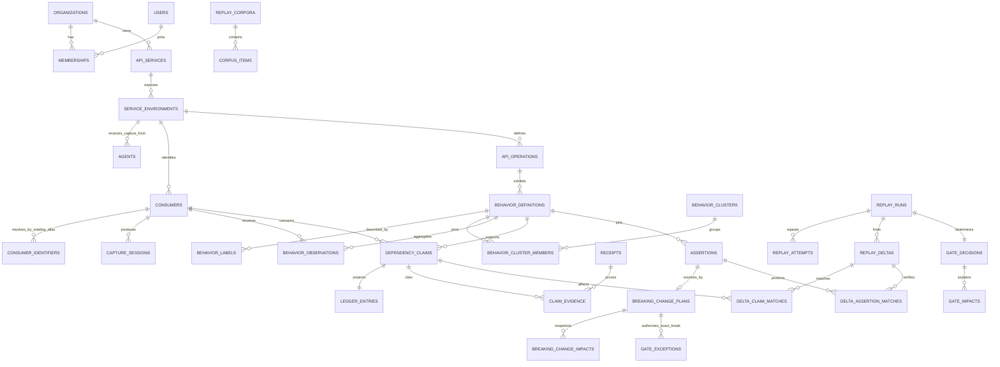

# Hyrum Database Schema

**Status:** Target application schema  
**Sources:** [`PRD.md`](./PRD.md), [`TECH_STACK.md`](./TECH_STACK.md), and the current scaffold  
**Database:** PostgreSQL 16+ with Drizzle ORM and explicit SQL migrations

## 1. Scope and design principles

This document defines the complete relational model for Hyrum's hosted control plane. It covers
tenant identity, monitored APIs, capture and redaction metadata, observed behavior, dependency
evidence, the accidental-contract ledger, assertions, replay and gate decisions, integrations,
notifications, AI provenance, background work, evaluation, and auditability.

Raw API traffic does not belong in PostgreSQL. The customer-side Go agent redacts traffic before
egress. Redacted receipt bundles, immutable replay corpora, uploaded OpenAPI files, and replay reports
live in R2-compatible object storage; PostgreSQL stores their metadata, digests, relationships, small
approved excerpts, and lifecycle state.

The model follows these non-negotiable rules:

- Every tenant-owned row carries `organization_id`, and every repository/service method receives it
  explicitly. Cross-tenant references are prevented with composite foreign keys where PostgreSQL and
  Drizzle permit them.
- Deterministic fingerprints and signed replay results are facts. AI labels, explanations, and tier
  proposals are versioned advisory records and cannot overwrite those facts.
- A blocking result requires a stable replay delta matched to an effective T1 claim backed by a
  complete response-to-later-request echo receipt. T2 can warn; T3 is exposure and never blocks.
- Content-addressed and versioned entities are immutable. Corrections create superseding rows rather
  than rewriting history.
- Operational state changes that trigger asynchronous work write an `outbox_events` row in the same
  transaction.
- Evidence TTL deletion removes object bodies while retaining non-sensitive ledger metadata and an
  explicit record that the receipt expired.
- Timing and latency observations are not represented because the PRD explicitly excludes them.

## 2. Global conventions

### 2.1 Keys and tenant integrity

- Application entities use UUIDv7-compatible `uuid` primary keys. PostgreSQL-generated random UUIDs
  are acceptable until UUIDv7 generation is added.
- High-volume append-only tables may use `bigint generated always as identity` as part of a composite
  primary key with the partition key.
- Every tenant-owned parent exposes `UNIQUE (organization_id, id)`. Child tables use
  `(organization_id, parent_id) -> (organization_id, id)` where practical so an ID from one tenant
  cannot be attached to another tenant's row.
- Global catalog tables, such as extractor releases and prompt versions, do not carry
  `organization_id` and are read-only to tenant users.
- External identifiers are namespaced and unique, for example `workos_user_id`,
  `(github_installation_id, repository_id)`, and `(agent_id, batch_id)`.

### 2.2 Common columns

Mutable application tables normally include:

| Column                     | Type          | Rule                                                       |
| -------------------------- | ------------- | ---------------------------------------------------------- |
| `id`                       | `uuid`        | Primary key                                                |
| `organization_id`          | `uuid`        | Required tenant FK unless explicitly global                |
| `created_at`               | `timestamptz` | Required, defaults to `now()`                              |
| `updated_at`               | `timestamptz` | Required, updated by application/repository code           |
| `deleted_at`               | `timestamptz` | Nullable; only for recoverable user-managed resources      |
| `created_by_membership_id` | `uuid`        | Nullable for machine/system-created rows; tenant-scoped FK |

Append-only evidence and audit tables have `created_at` but no `updated_at`. Object expiry and
retention deletion are represented with `expires_at`, `deleted_at`, and `deletion_reason` rather than
soft-deleting every analytical row.

### 2.3 Deletion policy

- `organizations`, `api_services`, `service_environments`, `consumers`, and integrations are
  soft-deleted or disabled first. They are hard-deleted only through an audited retention workflow.
- Membership revocation uses `status` and `revoked_at`; history remains for audit references.
- Specs, policy versions, configuration versions, fingerprints, claims, assertions, replay results,
  gate decisions, model runs, and audit events are never updated into a different historical fact.
- Receipt/corpus bodies are hard-deleted from object storage at TTL. Their metadata rows remain with
  `availability_status = 'expired'` unless the organization is fully erased.
- Tenant erasure runs asynchronously, records a deletion manifest, removes object prefixes, and then
  hard-deletes tenant rows in dependency order.

### 2.4 Core enums

Use PostgreSQL enums for values that participate in constraints and policy. Add values only through
forward-compatible migrations.

| Enum                   | Values                                                                                                                                                             |
| ---------------------- | ------------------------------------------------------------------------------------------------------------------------------------------------------------------ |
| `organization_status`  | `provisioning`, `active`, `suspended`, `deleting`, `deleted`                                                                                                       |
| `organization_role`    | `owner`, `admin`, `engineer`, `viewer`                                                                                                                             |
| `membership_status`    | `invited`, `active`, `suspended`, `revoked`                                                                                                                        |
| `service_status`       | `onboarding`, `active`, `paused`, `archived`                                                                                                                       |
| `environment_kind`     | `production`, `staging`, `development`, `demo`                                                                                                                     |
| `agent_status`         | `pending`, `online`, `degraded`, `offline`, `revoked`                                                                                                              |
| `object_kind`          | `api_spec`, `capture_batch`, `receipt_bundle`, `replay_corpus`, `replay_report`, `fixture_bundle`, `generated_artifact`, `evaluation_dataset`, `deletion_manifest` |
| `object_availability`  | `pending`, `available`, `expired`, `quarantined`, `deleted`, `failed`                                                                                              |
| `object_scan_status`   | `not_required`, `pending`, `clean`, `infected`, `failed`                                                                                                           |
| `behavior_kind`        | `shape`, `ordering`, `error_template`                                                                                                                              |
| `declaration_status`   | `undeclared`, `declared`, `partially_declared`, `not_applicable`                                                                                                   |
| `evidence_tier`        | `t1`, `t2`, `t3`                                                                                                                                                   |
| `claim_status`         | `proposed`, `active`, `disputed`, `dismissed`, `stale`, `superseded`                                                                                               |
| `review_state`         | `unreviewed`, `confirmed`, `demoted`, `promoted`, `dismissed`                                                                                                      |
| `freshness_status`     | `fresh`, `aging`, `stale`                                                                                                                                          |
| `assertion_status`     | `active`, `expiring`, `expired`, `resolved`, `cancelled`                                                                                                           |
| `assertion_resolution` | `documented`, `extended`, `deliberately_broken`, `cancelled`                                                                                                       |
| `corpus_status`        | `building`, `ready`, `superseded`, `expired`, `failed`                                                                                                             |
| `replay_status`        | `queued`, `running`, `succeeded`, `failed`, `cancelled`                                                                                                            |
| `delta_stability`      | `pending`, `stable`, `flaky`, `quarantined`                                                                                                                        |
| `gate_outcome`         | `pass`, `note`, `warn`, `block`, `error`, `cancelled`                                                                                                              |
| `integration_status`   | `pending`, `active`, `degraded`, `revoked`                                                                                                                         |
| `notification_status`  | `queued`, `sent`, `failed`, `suppressed`, `cancelled`                                                                                                              |
| `job_status`           | `pending`, `running`, `succeeded`, `failed`, `dead`, `cancelled`                                                                                                   |
| `llm_run_status`       | `queued`, `running`, `succeeded`, `rejected`, `failed`, `cancelled`                                                                                                |

Permission names remain application constants rather than database enums so additive permissions do
not require an enum migration. The initial roles are fixed in code and tested against the permission
matrix in §4.5.

## 3. Relationship overview

## 4. Identity, tenancy, and authorization

### 4.1 `organizations`

**Purpose:** Top-level tenant and data-isolation boundary.

| Field                                    | Type                  | Notes                                |
| ---------------------------------------- | --------------------- | ------------------------------------ |
| `id`                                     | `uuid` PK             | Internal tenant ID                   |
| `workos_organization_id`                 | `text`                | Unique WorkOS organization reference |
| `slug`                                   | `citext`              | Unique public workspace slug         |
| `name`                                   | `text`                | Required display name                |
| `status`                                 | `organization_status` | Defaults to `provisioning`           |
| `region`                                 | `text`                | Data residency/deployment region     |
| `retention_days`                         | `smallint`            | 1–365; default 30                    |
| `stale_after_days`                       | `smallint`            | Default 90; positive                 |
| `settings_version`                       | `integer`             | Optimistic configuration revision    |
| `created_at`, `updated_at`, `deleted_at` | timestamps            | Standard lifecycle                   |

Indexes: unique lower-case `slug`, unique `workos_organization_id`, partial index on active tenants.
Deletion is restricted while required retention/export work is pending.

### 4.2 `organization_settings`

**Purpose:** One-to-one mutable tenant preferences that should not widen the core organization row.

Fields: `organization_id uuid PK/FK`, `timezone text`, `default_assertion_days smallint DEFAULT 90`,
`default_receipt_ttl_days smallint`, `low_volume_sampling_boost numeric(5,2)`,
`notification_digest_enabled boolean`, `data_export_enabled boolean`, `created_at`, `updated_at`.
Checks keep retention within the parent organization's limit and assertion duration positive.

### 4.3 `users`

**Purpose:** Global human identity mirrored from WorkOS; a person may belong to multiple tenants.

Fields: `id uuid PK`, `workos_user_id text UNIQUE`, `primary_email citext`, `display_name text`,
`avatar_url text`, `last_authenticated_at timestamptz`, `created_at`, `updated_at`, `deleted_at`.
Email is not an authorization key and may change. Do not cascade-delete audit history when a user is
deactivated.

### 4.4 `memberships`

**Purpose:** Many-to-many user-to-organization relationship and product authorization principal.

Fields: `id uuid PK`, `organization_id`, `user_id`, `workos_membership_id text`,
`role organization_role`, `status membership_status`, `joined_at`, `suspended_at`, `revoked_at`,
`created_at`, `updated_at`. Constraints: unique `(organization_id, user_id)`, unique non-null
`workos_membership_id`, and at least one active owner per active organization enforced transactionally.
Indexes: `(user_id, status)` and `(organization_id, role, status)`.

### 4.5 Role and permission policy

Roles are organization-scoped; Hyrum does not need a customer-visible global super-admin.

| Capability                                             |    Owner    |       Admin        |      Engineer       | Viewer |
| ------------------------------------------------------ | :---------: | :----------------: | :-----------------: | :----: |
| Read ledger, consumers, replays, and redacted receipts |     Yes     |        Yes         |         Yes         |  Yes   |
| Pin/resolve assertions                                 |     Yes     |        Yes         |         Yes         |   No   |
| Confirm/promote/demote/dismiss claims                  | Recent auth |    Recent auth     |     Recent auth     |   No   |
| Run replay and manage corpora                          |     Yes     |        Yes         |         Yes         |   No   |
| Manage services, specs, agents, repositories, Slack    |     Yes     |        Yes         | Limited install/use |   No   |
| Manage gate and retention policies                     |     Yes     |        Yes         |         No          |   No   |
| Approve exact-candidate deliberate-break exceptions    |     Yes     |        Yes         |    Request only     |   No   |
| Invite/remove members or change roles                  |     Yes     | Yes, except owners |         No          |   No   |
| Delete organization or transfer ownership              |     Yes     |         No         |         No          |   No   |

Permissions are enforced in the API service layer and repeated in repository authorization tests. RLS
is defense in depth, not the primary policy engine.

### 4.6 `invitations`

**Purpose:** Tracks pending organization invitations and onboarding state when WorkOS events are
eventually delivered.

Fields: `id`, `organization_id`, `email citext`, `role`, `workos_invitation_id`, `invited_by_membership_id`,
`status` (`pending`, `accepted`, `expired`, `revoked`), `expires_at`, `accepted_at`, timestamps. Unique
partial index on `(organization_id, lower(email)) WHERE status = 'pending'`.

### 4.7 `platform_operators`

**Purpose:** Narrow internal operations identity for service health, abuse response, and audited
break-glass support. It is not a tenant role and grants no implicit tenant data access.

Fields: `id`, `user_id UNIQUE`, `status` (`active`, `suspended`), `capabilities text[]`,
`created_at`, `revoked_at`. Creation requires out-of-band administrative control.

### 4.8 `support_access_grants`

**Purpose:** Time-bounded, reasoned access by a platform operator to one organization.

Fields: `id`, `organization_id`, `platform_operator_id`, `approved_by_operator_id`, `reason`,
`ticket_reference`, `scopes text[]`, `starts_at`, `expires_at`, `revoked_at`, `created_at`. Checks:
expiry after start, approver differs from requester for sensitive scopes, maximum duration enforced by
policy. Every use writes an `audit_events` record.

### 4.9 `organization_key_versions`

**Purpose:** Rotation metadata for tenant-derived structural-HMAC and envelope-encryption keys without
placing key material in PostgreSQL.

Fields: `id`, `organization_id`, `purpose` (`consumer_identity_hmac`, `structural_hmac`,
`integration_encryption`, `object_encryption`), `version`, `kms_key_reference`, `status` (`pending`,
`active`, `retiring`, `retired`, `revoked`), `activated_at`, `retire_after`, `created_at`. Unique
`(organization_id, purpose, version)` and partial unique active version per purpose. Rotation may keep
one retiring HMAC version during a bounded equality-comparison overlap; hashes from different tenants
remain incomparable. Key material is generated and used through the approved secret/KMS boundary and
is never returned by ordinary product APIs.

## 5. Monitored APIs and versioned configuration

### 5.1 `api_services`

**Purpose:** A customer API/product being monitored and gated.

Fields: `id`, `organization_id`, `name`, `slug`, `description`, `status service_status`,
`owner_membership_id`, `first_capture_at`, `first_useful_ledger_at`, timestamps, `deleted_at`. Unique
active `(organization_id, slug)`. An organization can own many services. The default environment is
the child row with `is_default = true`, avoiding a circular service/environment foreign key.
`first_useful_ledger_at` is set once when the versioned usefulness rule first observes a non-T3-only,
receipt-backed ledger result; it is not moved later to improve the time-to-ledger metric.

### 5.2 `service_environments`

**Purpose:** Separates production capture from staging/demo traffic and binds environment-specific
agents/configuration.

Fields: `id`, `organization_id`, `api_service_id`, `name`, `slug`, `kind environment_kind`,
`base_url_origin text` (origin only, no credentials/query), `capture_enabled`, `is_default`, timestamps,
`deleted_at`. Unique `(api_service_id, slug)` and partial unique one default environment per service.

### 5.3 `extractor_releases`

**Purpose:** Global immutable catalog of the shared Go extraction/masking implementation.

Fields: `id`, `semantic_version text UNIQUE`, `source_commit_sha text`, `binary_digest text`,
`fingerprint_schema_version integer`, `released_at`, `deprecated_at`. Capture and replay records must
reference the same release for directly comparable results.

### 5.4 `redaction_policy_versions`

**Purpose:** Immutable CEL-based capture redaction and allow/deny policy versions.

Fields: `id`, `organization_id`, `api_service_id`, `version integer`, `status` (`draft`, `active`,
`superseded`, `invalid`), `cel_source text`, `compiled_digest text`,
`structural_hmac_key_version_id`, `consumer_hmac_key_version_id`, `created_by_membership_id`,
`activated_at`, `created_at`. Unique `(api_service_id, version)` and one active version per service.
Both key references must belong to the same organization and have the required purpose. Never store
HMAC key material.

### 5.5 `sampling_policy_versions`

**Purpose:** Immutable session-window and low-volume boost configuration.

Fields: `id`, tenant/service FKs, `version`, `session_window_seconds`, `base_sample_rate numeric(6,5)`,
`low_volume_threshold integer`, `low_volume_boost numeric(6,2)`, `correlation_header_names text[]`
(approved names only), `compiled_digest`, `status`, creator/activation timestamps. Unique service/version.

### 5.6 `mask_profile_versions`

**Purpose:** Immutable replay normalization rules for nondeterministic IDs, timestamps, hashes, and
customer-configured fields.

Fields: `id`, tenant/service FKs, `version`, `rules jsonb`, `rules_digest`, `status`, creator and
activation timestamps. JSON is schema-validated; arbitrary executable code is forbidden.

### 5.7 `replay_profiles`

**Purpose:** Versioned replay environment contract: safe operations, fixture seed, side-effect stubs,
network policy, resource limits, and linked mask profile.

Fields: `id`, tenant/service FKs, `version`, `name`, `mask_profile_version_id`,
`fixture_object_id`, `stub_object_id`, `allowed_operation_mode` (`read_only`, `explicit_writes`),
`network_egress_enabled boolean DEFAULT false`, `request_timeout_ms`, `resource_limits jsonb`,
`config_digest`, `status`, timestamps. Unique `(api_service_id, version)`.

### 5.8 `onboarding_progress`

**Purpose:** One-to-one resumable setup state for a service without making setup completion a source of
truth for the configured resources.

Fields: `api_service_id PK`, `organization_id`, `current_step`, `completed_steps text[]`,
`dismissed_steps text[]`, `last_error_code`, `completed_at`, `updated_at`. Steps are derived/verified
against actual spec, agent, capture, repository, and policy records before being marked complete.

## 6. Agents, machine credentials, and capture ingestion

### 6.1 `agents`

**Purpose:** Installed customer-side Go capture processes.

Fields: `id`, tenant/service/environment FKs, `name`, `external_instance_key`, `status agent_status`,
`adapter_type` (`ndjson`, `http_proxy`, `kong`, `envoy_als`, `log_tap`), `agent_version`,
`extractor_release_id`, active redaction/sampling config IDs, `config_revision`, `last_seen_at`,
`last_error_code`, `revoked_at`, timestamps. Unique `(organization_id, external_instance_key)` and
index `(environment_id, status, last_seen_at)`.

### 6.2 `machine_credentials`

**Purpose:** Revocable credentials for capture agents; plaintext is shown once and never stored. CI
replay uses the shorter-lived, replay-bound `ci_runner_sessions` exchange in §11.5.

Fields: `id`, `organization_id`, `agent_id`, `token_prefix`, `token_hash`, `scopes text[]`,
`expires_at`, `last_used_at`, `rotated_from_id`, `revoked_at`, timestamps. Unique token prefix globally
and tenant-scoped FK to the agent. Hash with Argon2id plus server-side pepper.

### 6.3 `ingestion_batches`

**Purpose:** Idempotent acceptance record for a compressed agent upload and its per-batch processing
state.

Fields: `id`, tenant/service/environment/agent FKs, `agent_batch_id text`, `stored_object_id`,
`payload_digest`, `schema_version`, `extractor_release_id`, redaction/sampling policy version IDs,
`session_count`, `accepted_item_count`, `rejected_item_count`, `status` (`received`, `validated`,
`processing`, `processed`, `partially_rejected`, `failed`), `received_at`, `processed_at`,
`failure_code`, `rejection_manifest_object_id` nullable, `rejection_summary jsonb`. Unique
`(agent_id, agent_batch_id)` and `(organization_id, payload_digest, agent_id)` where replaying a batch
must return the original result. Per-item rejection details use a bounded redacted manifest rather than
an unbounded row per captured event.

### 6.4 `consumers`

**Purpose:** Stable, opaque API consumer identity within one service environment.

Fields: `id`, tenant/service/environment FKs, `display_alias`, `alias_source` (`generated`, `customer`,
`integration`), `first_seen_at`, `last_seen_at`, `request_count bigint`, `low_volume boolean`,
`metadata jsonb` (approved non-secret tags), timestamps, `deleted_at`. The UUID is the stable consumer
identity; versioned HMAC aliases live in `consumer_identifiers`. Never store original API keys/client
secrets. Trigram index on approved alias text.

### 6.5 `consumer_identifiers`

**Purpose:** Maps one stable consumer to one or more versioned opaque identifiers so HMAC rotation does
not split historical identity or make hashes comparable across tenants.

Fields: `id`, tenant/environment/consumer FKs, `identity_source` (`api_key`, `client_id`,
`configured_header`), `identifier_hmac`, `consumer_hmac_key_version_id`, `is_primary`, `first_seen_at`,
`last_seen_at`, `retired_at`, `created_at`. Unique
`(environment_id, consumer_hmac_key_version_id, identifier_hmac)` and partial unique primary identifier
per consumer/key version. During a bounded rotation overlap the agent emits current and retiring
identifier aliases; the control plane attaches both to the same stable consumer in one transaction.
After overlap, retiring aliases remain for historical resolution but are not accepted for new agent
configuration. Original identifiers are never stored.

### 6.6 `capture_sessions`

**Purpose:** Preserves consumer request sequences needed for T1 inference.

Fields: `id`, tenant/environment/agent/consumer/batch FKs, `session_hmac`, `started_at`, `ended_at`,
`first_sequence_no bigint`, `last_sequence_no bigint`, `event_count`, `completeness` (`complete`,
`partial_start`, `partial_end`, `gapped`), `correlation_source`, `sampling_probability`,
`low_volume_boost_applied`, `structural_hmac_key_version_id`, `receipt_bundle_object_id`, `expires_at`,
`created_at`. Unique `(environment_id, consumer_id, session_hmac, started_at)`. The structural key
version must match the redaction policy recorded by the ingestion batch. Index consumer/time and
expiry.

Individual request/response bodies are not rows. Sequence bodies and allowed excerpts remain in the
redacted bundle; evidence tables store only the offsets and paths required to locate proof.

## 7. Object storage metadata

### 7.1 `stored_objects`

**Purpose:** Authoritative metadata for every R2/MinIO object referenced by relational entities.

Fields: `id`, `organization_id`, `kind object_kind`, `bucket`, `object_key`, `content_type`,
`content_encoding`, `byte_size bigint`, `sha256_digest`, `encryption_key_version_id` nullable,
`scan_status object_scan_status`, `scanned_at`, `scan_failure_code`,
`availability_status object_availability`, `expires_at`, `verified_at`, `deleted_at`, `deletion_reason`,
`created_by_actor_type`, `created_by_actor_id`, `created_at`. Unique `(bucket, object_key)` and
`(organization_id, kind, sha256_digest)` where deduplication is safe. A key reference must belong to the
same organization and have `object_encryption` purpose. Uploaded specs, fixture/stub archives, and
generated downloadable artifacts remain unavailable until required content-type, size, digest, and
malware checks pass; an infected or unverifiable object is quarantined and never receives a signed
URL. Index expiry and pending scans. Object keys are opaque, tenant-prefixed, and never user-derived.

## 8. API specifications and operations

### 8.1 `api_specs`

**Purpose:** Immutable uploaded OpenAPI versions, original and normalized.

Fields: `id`, tenant/service FKs, `version_label`, `source` (`upload`, `github`, `generated_draft`),
`source_reference`, `original_object_id`, `normalized_object_id`, `original_digest`,
`normalized_digest`, `openapi_version`, `validation_status`, `validation_errors jsonb`,
`is_current boolean`, `supersedes_spec_id`, `uploaded_by_membership_id`, `created_at`. Unique service +
normalized digest; partial unique current spec per service. Remote `$ref` resolution is disabled by
default and no fetched URL with credentials is stored.

### 8.2 `api_operations`

**Purpose:** Stable endpoint identity across spec versions and observations.

Fields: `id`, tenant/service FKs, `http_method`, `normalized_path_template`, `operation_key`,
`display_name`, `first_seen_at`, `last_seen_at`, `archived_at`, timestamps. Unique
`(api_service_id, http_method, normalized_path_template)`; `operation_key` is a deterministic digest.

### 8.3 `api_spec_operations`

**Purpose:** Many-to-many versioned declaration of stable operations in each immutable spec.

Fields: `id`, tenant FKs, `api_spec_id`, `api_operation_id`, `operation_id_text`, `summary`,
`normalized_contract jsonb`, `contract_digest`, `created_at`. Unique `(api_spec_id,
api_operation_id)`. GIN indexes are optional only for measured contract queries.

## 9. Behaviors, observations, receipts, and ledger

### 9.1 `behavior_definitions`

**Purpose:** Canonical deterministic identity of an observable behavior for an operation.

Fields: `id`, tenant/service/operation FKs, `kind behavior_kind`, `fingerprint_schema_version`,
`extractor_release_id`, `canonical_fingerprint jsonb`, `fingerprint_digest`, `default_label`,
`first_seen_at`, `last_seen_at`, `created_at`. Unique `(api_operation_id, extractor_release_id,
fingerprint_digest)`. `default_label` is a deterministic fallback generated from the behavior
kind/path/template; reviewed human/model labels live in `behavior_labels`. A label is never identity.

Examples include a response path's absent/null/type pattern, a stable pagination ordering key, or a
normalized status/error-template digest. Timing fields are prohibited.

### 9.2 `behavior_labels`

**Purpose:** Immutable, reviewable human-facing names and descriptions without changing deterministic
behavior identity.

Fields: `id`, tenant/behavior FKs, `label`, `description`, `source` (`deterministic`, `model`, `human`),
optional `llm_run_id`, `status` (`proposed`, `active`, `rejected`, `superseded`),
`reviewed_by_membership_id`, `supersedes_label_id`, `created_at`. One active label per behavior;
activating a model label requires schema/citation validation and an authorized review or configured
low-risk auto-accept policy. The deterministic fallback remains available when AI fails.

### 9.3 `behavior_clusters`

**Purpose:** Advisory grouping of related deterministic behaviors for navigation and naming; clusters
never affect evidence tiers or gates.

Fields: `id`, tenant/service FKs, `label`, `description`, `source` (`model`, `human`), optional
`llm_run_id`, `input_digest`, `status` (`proposed`, `active`, `rejected`, `superseded`),
`supersedes_cluster_id`, `reviewed_by_membership_id`, `created_at`. Cluster versions are immutable and
one superseding chain represents each conceptual grouping.

### 9.4 `behavior_cluster_members`

**Purpose:** Many-to-many membership of deterministic behaviors in an advisory cluster version.

Fields: tenant/cluster/behavior FKs, `membership_source` (`model`, `human`),
`score numeric(5,4)` nullable, `created_at`; composite PK
`(behavior_cluster_id, behavior_definition_id)`. Membership has no policy authority and may cross
operations only within the same service and tenant.

### 9.5 `behavior_spec_classifications`

**Purpose:** Reproducible result of subtracting a behavior from a particular spec version.

Fields: `id`, tenant FKs, `behavior_definition_id`, `api_spec_id`,
`status declaration_status`, `reason_code`, `comparison_details jsonb`, `comparator_version`,
`created_at`. Unique `(behavior_definition_id, api_spec_id, comparator_version)`. The effective
classification uses the service's current spec and newest approved comparator version.

### 9.6 `behavior_observations`

**Purpose:** Time-bucketed endpoint × consumer × behavior aggregates without retaining raw request
volume as individual rows.

Fields: `organization_id`, `bucket_start timestamptz`, `id bigint identity`, environment/operation/
consumer/behavior FKs, `observation_count bigint`, `session_count bigint`, `first_seen_at`,
`last_seen_at`, `sample_weight numeric`, `support_metrics jsonb`, `created_at`. Primary key
`(bucket_start, id)`; unique bucket/dimensions; monthly range partition on `bucket_start`. Indexes:
`(organization_id, behavior_definition_id, consumer_id, bucket_start DESC)` and
`(organization_id, api_operation_id, bucket_start DESC)`.

### 9.7 `receipts`

**Purpose:** Metadata and authorization boundary for a bounded redacted evidence bundle.

Fields: `id`, tenant/service/environment/consumer/session FKs, `stored_object_id`, `receipt_type`
(`t1_echo`, `t2_pattern`, `exposure`, `replay_delta`, `assertion`), `bundle_digest`,
`redaction_policy_version_id`, `extractor_release_id`, `sequence_start`, `sequence_end`,
`completeness`, `approved_excerpt text` nullable and length-limited, `availability_status`,
`expires_at`, `created_at`. Index claim lookup dimensions and expiry. Signed URLs are generated only
after permission checks and are never persisted.

### 9.8 `dependency_claims`

**Purpose:** Versioned evidence-tier conclusion for one consumer and one undeclared behavior. T3 rows
represent exposure, not proven dependency, despite the historical table name.

Fields: `id`, tenant/service/environment/consumer/behavior FKs, `tier evidence_tier`,
`status claim_status`, `rule_version`, `deterministic_eligible boolean`, `support_count`,
`confidence numeric(5,4)` nullable for T2 only, `effective_from`, `effective_until`,
`supersedes_claim_id`, `proposed_by` (`rules`, `model`, `human`), `llm_run_id` nullable,
`created_at`. Unique partial active claim per behavior + consumer. Checks: T1 requires deterministic
eligibility; T3 confidence is null; a model proposal cannot become active T1 until deterministic
validation succeeds.

### 9.9 `claim_evidence`

**Purpose:** Many-to-many citations connecting a claim to one or more receipts with machine-checkable
locations.

Fields: `id`, tenant FKs, `dependency_claim_id`, `receipt_id`, `evidence_role` (`primary`,
`supporting`, `counterexample`), `response_sequence_no`, `request_sequence_no`, `response_json_path`,
`request_json_path`, `value_hmac`, `structural_hmac_key_version_id`, `pattern_metrics jsonb`,
`created_at`. Unique claim/receipt/location. For T1, require later request sequence > response
sequence, a complete session, equal tenant-scoped HMAC values produced under the same active/retiring
structural key version, and at least one primary receipt.

### 9.10 `claim_review_decisions`

**Purpose:** Append-only human confirmations, promotions, demotions, and dismissals without changing
raw evidence.

Fields: `id`, tenant/claim FKs, `membership_id`, `decision review_state`, `from_tier`, `to_tier`,
`reason`, `recent_auth_at`, `supersedes_decision_id`, `created_at`. Only the newest non-superseded
decision is effective. A promotion to T1 still requires deterministic T1 eligibility.

### 9.11 `ledger_entries`

**Purpose:** One-to-one product-facing lifecycle/read model for a claim, preserving ownership,
freshness, and review workflow independently of raw inference history.

Fields: `id`, tenant/claim FKs (`dependency_claim_id UNIQUE`), `owner_membership_id`,
`review_state`, `freshness_status`, `first_detected_at`, `last_observed_at`, `stale_at`,
`acknowledged_at`, `resolved_at`, `resolution_note`, `search_document tsvector`, timestamps.
Indexes combine organization with tier/status/freshness/operation/consumer through maintained search
columns or a tenant-scoped materialized view. A nightly job marks entries stale after the tenant's
configured threshold; it never erases the original claim.

## 10. Assertions and lifecycle

### 10.1 `assertions`

**Purpose:** Time-bounded compatibility promise that forces a behavior into every relevant replay.

Fields: `id`, tenant/service/behavior FKs, optional `source_claim_id`, `owner_membership_id`, `reason`,
`status assertion_status`, `scope` (`all_consumers`, `selected_consumers`), `starts_at`, `expires_at`,
`remind_at`, `resolution assertion_resolution` nullable, `resolved_at`,
`resolved_by_membership_id`, `supersedes_assertion_id`, timestamps. Checks: owner, non-empty reason,
and future expiry are mandatory at creation; default expiry is 90 days. Partial index on active expiry.

### 10.2 `assertion_consumers`

**Purpose:** Many-to-many scope when an assertion applies only to selected consumers.

Fields: tenant/assertion/consumer FKs, `created_at`; composite PK `(assertion_id, consumer_id)`.
Rows are prohibited for `scope = 'all_consumers'`.

### 10.3 `assertion_events`

**Purpose:** Append-only lifecycle history for pin, extend, document, schedule break, reassign, expire,
and cancel actions.

Fields: `id`, tenant/assertion FKs, `event_type`, `actor_type`, `actor_id`, `reason`,
`previous_expiry`, `new_expiry`, `metadata jsonb`, `created_at`. Extension requires justification and
creates both an event and a new assertion version or updated lifecycle record under transaction.

### 10.4 `breaking_change_plans`

**Purpose:** One-to-one, explicit schedule and ownership record for a deliberate incompatible change.

Fields: `id`, tenant/service/assertion/behavior FKs, `owner_membership_id`, `planned_for timestamptz`,
`status` (`draft`, `scheduled`, `communication_ready`, `completed`, `cancelled`), `reason`,
`communication_due_at`, `completed_at`, `cancelled_at`, `created_at`, `updated_at`. Unique
`assertion_id`; planned time must be in the future and no later than the assertion expiry when
scheduled. If more time is needed, the assertion is explicitly extended with justification first.
Scheduling snapshots impacted consumers in `breaking_change_impacts`, writes an assertion/audit event,
and does not itself modify an API spec, notify external customers, or resolve the assertion. The
assertion remains active and stays in every relevant corpus until the exact intended break is approved,
exercised, and completed.

### 10.5 `breaking_change_impacts`

**Purpose:** Immutable per-consumer blast-radius snapshot used to review and draft deliberate-break
communications even if later observations or claims change.

Fields: `id`, tenant/plan/consumer FKs, optional `dependency_claim_id`, `evidence_tier`,
`impact_digest`, `last_observed_at`, `receipt_id` nullable, `communication_status` (`pending`,
`drafted`, `reviewed`, `exported`, `acknowledged`, `excluded`), `exclusion_reason`, `created_at`,
`updated_at`. Unique `(breaking_change_plan_id, consumer_id)`. Hyrum stores no customer contact details
and does not claim a notice was sent merely because a draft was exported.

### 10.6 `generated_drafts`

**Purpose:** Human-reviewable AI drafts for OpenAPI changes, impact explanations, and customer notices.

Fields: `id`, tenant/service FKs, `draft_type` (`impact_explanation`, `spec_patch`,
`customer_notice`), optional behavior/cluster/assertion/breaking-change/replay/gate FKs, `llm_run_id`,
`content_object_id` nullable, `content_excerpt text`, `status` (`draft`, `accepted`, `rejected`,
`published`), `reviewed_by_membership_id`, `reviewed_at`, `created_at`. Drafts never mutate specs,
gates, or send notifications without a human/system action that is separately authorized and audited.
For v1, a `spec_patch` marked published means reviewed/exported for a human-created PR; the approved
GitHub App has Contents and Pull Requests read permissions and cannot silently write a branch or PR.

## 11. Replay corpora, differential replay, and gates

### 11.1 `replay_corpora`

**Purpose:** Immutable, coverage-curated corpus version for a service/environment.

Fields: `id`, tenant/service/environment FKs, `version`, `status corpus_status`, `stored_object_id`,
`corpus_digest`, `extractor_release_id`, `selection_algorithm_version`, `source_window_start/end`,
`item_count`, `operation_count`, `consumer_count`, `assertion_count`, `expires_at`,
`supersedes_corpus_id`, `created_at`. Unique `(environment_id, version)` and corpus digest.

### 11.2 `corpus_items`

**Purpose:** Searchable coverage manifest for immutable requests stored in a corpus bundle.

Fields: `id`, tenant/corpus/operation/consumer FKs, optional behavior/assertion FKs,
`coverage_class` (`shape`, `ordering`, `error_template`, `assertion`, `negative_control`),
`object_offset`, `request_digest`, `method`, `normalized_path`, `safe_method boolean`,
`requires_fixture boolean`, `selection_reason`, `priority_rank`, `created_at`. Unique corpus + request
digest + coverage class. Request bodies remain in object storage.

### 11.3 `replay_runs`

**Purpose:** One requested comparison between immutable base and candidate builds.

Fields: `id`, tenant/service/environment FKs, `replay_corpus_id`, `replay_profile_id`,
`extractor_release_id`, `gate_policy_version_id`, optional repository/PR FKs, `trigger_type` (`manual`,
`pull_request`, `assertion`, `evaluation`, `demo`), `base_image_digest`, `candidate_image_digest`,
`fixture_digest`, `mask_digest`, `runner_version`, `status replay_status`, `requested_by_actor_type/id`,
`started_at`, `completed_at`, `failure_code`, `report_object_id`, `report_digest`,
`signature_key_id`, `signature_verified_at`, timestamps. Composite uniqueness on the full immutable
input tuple plus trigger idempotency key.

### 11.4 `replay_attempts`

**Purpose:** Repeated execution used to establish delta stability.

Fields: `id`, tenant/run FKs, `attempt_number`, `status`, `runner_instance_id`, `started_at`,
`completed_at`, `result_digest`, `report_object_id`, `failure_code`, `created_at`. Unique
`(replay_run_id, attempt_number)`. Changed cases must run at least twice; evaluation suites use at
least three runs.

### 11.5 `ci_runner_sessions`

**Purpose:** One-use, replay-bound authentication and report-signing exchange for a customer-controlled
GitHub Actions runner.

Fields: `id`, tenant/replay-run FKs, optional `github_repository_id`, `token_prefix`, `token_hash`,
`scopes text[]`, `nonce_digest`, `report_signing_public_key`, `signing_key_id`, `expires_at`,
`consumed_at`, `revoked_at`, `created_at`. Unique token prefix and one active session per replay run.
The token may download only the run's corpus/config and upload only that run's signed report; it expires
quickly and cannot be reused. Private signing material remains ephemeral in CI.

### 11.6 `replay_deltas`

**Purpose:** Deterministically measured observable difference between base and candidate.

Fields: `id`, tenant/run/operation FKs, optional behavior FKs for before/after identity,
`kind behavior_kind`, `delta_digest`, `normalized_before jsonb`, `normalized_after jsonb`,
`mask_applied jsonb`, `stability delta_stability`, `agreeing_attempts`, `total_attempts`,
`quarantine_reason`, `receipt_id`, `created_at`. Unique `(replay_run_id, delta_digest)`. A flaky or
quarantined delta is ineligible to block.

### 11.7 `delta_claim_matches`

**Purpose:** Deterministic many-to-many match between a proven replay delta and ledger claims.

Fields: `id`, tenant/delta/claim FKs, `match_rule_version`, `match_digest`, `matched boolean`,
`ineligibility_reason`, `created_at`. Unique delta + claim + rule version. It records negative or
ineligible matches when needed for a complete decision trace.

### 11.8 `delta_assertion_matches`

**Purpose:** Deterministic many-to-many match between a replay delta and an active compatibility
assertion included in the corpus.

Fields: `id`, tenant/delta/assertion FKs, `match_rule_version`, `match_digest`, `matched boolean`,
`ineligibility_reason`, `created_at`. Unique delta + assertion + rule version. Assertion matching is
separate from evidence-tier matching: a T2 claim alone remains warning-only, while a human-pinned
assertion is an explicit compatibility contract and follows `assertion_action`.

### 11.9 `gate_policies`

**Purpose:** Stable named policy identity per service/repository context.

Fields: `id`, tenant/service FKs, `name`, `description`, `is_default`, `created_by_membership_id`,
timestamps, `deleted_at`. Unique active service/name and one default per service.

### 11.10 `gate_policy_versions`

**Purpose:** Immutable policy used by a replay run.

Fields: `id`, tenant/policy FKs, `version`, `config jsonb`, `config_digest`, `t1_action gate_outcome`
restricted to block/warn/note, `t2_action` restricted to warn/note/pass, `t3_action` restricted to
note/pass, `assertion_action` restricted to block/warn/note, `flaky_action` restricted to
warn/note/pass, `minimum_stable_attempts`, `status`, `created_by_membership_id`, `activated_at`,
`created_at`. Unique policy/version and one active version. Database checks make a T3 block impossible;
the default actions are T1 block, T2 warn, T3 pass/note, active assertion block, and flaky warn because
pinning is an explicit human compatibility commitment while unpinned evidence retains its tier rules.

### 11.11 `gate_exceptions`

**Purpose:** Narrow, audited authorization to deliberately allow one scheduled T1/assertion break for
one exact candidate without changing evidence, claims, assertions, or the default gate policy.

Fields: `id`, tenant/service/breaking-change-plan/behavior FKs, optional repository/pull-request FKs,
`candidate_image_digest`, `status` (`pending`, `approved`, `used`, `revoked`, `expired`), `reason`,
`requested_by_membership_id`, `approved_by_membership_id`, `approved_at`, `recent_auth_at`,
`valid_from`, `valid_until`, `used_at`, `revoked_at`, `created_at`.
An approval requires owner/admin permission, a distinct approver where organization policy requires
four-eyes review, a future bounded expiry, and an exact behavior + candidate digest. It cannot be a
service-wide or tier-wide bypass and applies only to consumers frozen in the plan's impact snapshot.
Unique active exception per plan/behavior/candidate digest. Use is single-shot and audited.

### 11.12 `gate_decisions`

**Purpose:** One immutable aggregate decision for a completed replay run.

Fields: `id`, tenant/run FK (`replay_run_id UNIQUE`), `gate_policy_version_id`,
`outcome gate_outcome`, `decision_engine_version`, `decision_digest`, `blocking_impact_count`,
`warning_impact_count`, `noted_impact_count`, `evaluated_at`, `created_at`. A database trigger or
service transaction rejects `block` unless at least one eligible T1 claim impact or active assertion
impact exists. Explanations are looked up through `generated_drafts.gate_decision_id`, avoiding a
cyclic foreign key.

### 11.13 `gate_impacts`

**Purpose:** Per-consumer, per-behavior explanation trace behind a gate decision.

Fields: `id`, tenant/decision/delta FKs, exactly one of `dependency_claim_id` or `assertion_id`,
`effective_tier` nullable for assertion impacts, `action gate_outcome`, optional `gate_exception_id`,
`receipt_id` nullable, `reason_code`, `created_at`. Unique decision + delta + target. Checks enforce T2 is never
more severe than warn and T3 is never more severe than note. An otherwise blocking T1 or assertion
impact may be reduced only when a valid unused exception matches the exact behavior, candidate digest,
and snapshotted consumer/scope; consuming it and persisting the impact/decision are one transaction.

## 12. GitHub, Slack, webhooks, and notifications

### 12.1 `github_installations`

**Purpose:** Organization ownership of a GitHub App installation.

Fields: `id`, `organization_id`, `github_installation_id bigint UNIQUE`, `account_login`,
`account_type`, `status integration_status`, `permissions jsonb`, `installed_by_membership_id`,
`installed_at`, `suspended_at`, `deleted_at`, timestamps. Installation tokens are fetched just in time
and never stored.

### 12.2 `github_repositories`

**Purpose:** Tenant-owned GitHub repository identity independent of any one monitored API.

Fields: `id`, tenant/installation FKs, `github_repository_id bigint`, `owner_login`, `name`,
`default_branch`, `active`, `created_at`, `updated_at`, `deleted_at`. Unique
`(github_installation_id, github_repository_id)`.

### 12.3 `service_repository_connections`

**Purpose:** Many-to-many mapping from monitored API services to repositories, with service-specific
spec, workflow, replay, and gate configuration. This supports monorepos and services split across
multiple repositories.

Fields: `id`, tenant/service/repository FKs, `gate_policy_id`, `replay_profile_id`, `spec_path`,
`workflow_path`, `base_image_build_ref`, `candidate_image_build_ref`, `active`, `created_at`,
`updated_at`, `deleted_at`. Unique active `(api_service_id, github_repository_id, spec_path)`. Paths are
repository-relative, normalized, and may not escape the checkout. A pull request can therefore trigger
one independently authorized replay/check per matching service connection.

### 12.4 `pull_requests`

**Purpose:** Tenant-scoped PR state needed to correlate replay and Check Runs idempotently.

Fields: `id`, tenant/repository FKs, `github_pull_request_id bigint`, `number integer`, `head_sha`,
`base_sha`, `state`, `is_fork`, `author_login`, `opened_at`, `updated_from_github_at`, `closed_at`,
timestamps. Unique `(github_repository_id, number)`; index repository/head SHA.

### 12.5 `github_check_runs`

**Purpose:** Delivery state for a Hyrum gate decision in GitHub.

Fields: `id`, tenant/repository/PR FKs, `replay_run_id`, `gate_decision_id`,
`github_check_run_id bigint`, `external_id text`, `status`, `conclusion`, `details_url`,
`last_payload_digest`, `published_at`, `updated_at`, `failure_code`. Unique external ID and replay run.
The persisted Check conclusion is derived from `gate_decisions`, never from model prose.

### 12.6 `slack_installations`

**Purpose:** Slack workspace connection and encrypted token metadata.

Fields: `id`, `organization_id`, `slack_team_id`, `team_name`, `status integration_status`,
`encrypted_bot_token`, `encryption_key_version_id`, `scopes text[]`, `installed_by_membership_id`,
`installed_at`, `revoked_at`, timestamps. Unique `(organization_id, slack_team_id)`. Never log token
ciphertext or include it in exports. The key reference must belong to the organization and have
`integration_encryption` purpose.

### 12.7 `webhook_deliveries`

**Purpose:** Idempotency, signature verification result, and retry trace for inbound WorkOS, GitHub,
and Slack webhooks.

Fields: `id`, nullable `organization_id` until routing resolves, `provider`, `delivery_id`,
`event_type`, `payload_digest`, `signature_verified`, `received_at`, `processed_at`, `status`,
`attempts`, `last_error_code`. Unique `(provider, delivery_id)`. Do not store raw webhook bodies after
verification unless a separately redacted diagnostic object is explicitly allowed.

### 12.8 `notification_routes`

**Purpose:** Organization/service routing rules for gate, assertion, integration, and system events.

Fields: `id`, tenant/service FKs, `event_type`, `channel` (`in_app`, `slack`), optional
`slack_installation_id`, `destination_id` (channel ID, never a webhook URL), `minimum_severity`,
`enabled`, creator/timestamps. Unique active route tuple.

### 12.9 `notification_preferences`

**Purpose:** Per-membership in-app/digest preferences without allowing users to suppress mandatory
security or ownership notices.

Fields: `membership_id`, `organization_id`, `event_type`, `in_app_enabled`, `digest_enabled`,
`muted_until`, `updated_at`; composite PK membership/event type. Mandatory events ignore mute flags.

### 12.10 `notifications`

**Purpose:** Product notification intent and in-app inbox record.

Fields: `id`, tenant FKs, optional target membership/service/assertion/replay/gate IDs, `event_type`,
`severity`, `title`, `body_text` (no receipts/secrets), `deep_link_path`, `deduplication_key`,
`created_at`, `read_at`, `dismissed_at`. Unique `(organization_id, deduplication_key)`.

### 12.11 `notification_deliveries`

**Purpose:** One-to-many channel attempts for a notification.

Fields: `id`, tenant/notification/route FKs, `channel`, `status notification_status`,
`provider_message_id`, `attempts`, `next_attempt_at`, `sent_at`, `last_error_code`, timestamps. Unique
notification + route; index pending retries. Receipt contents are never copied into Slack payloads.

## 13. AI provenance and generated assistance

### 13.1 `prompt_versions`

**Purpose:** Global immutable registry of reviewed prompt and Structured Output schema versions.

Fields: `id`, `task_type`, `version`, `model_family`, `prompt_digest`, `schema_digest`,
`source_revision text`, `status` (`draft`, `evaluated`, `active`, `retired`), `created_at`,
`activated_at`. Unique task/version. Prompt templates are reviewed, source-controlled package assets;
production records retain their digest and source revision rather than copying full prompt text into
the database or general object store. Activation requires a successful `evaluation_runs` row that
references the prompt version; no reverse FK is needed.

### 13.2 `llm_runs`

**Purpose:** Complete provenance, cost, validation, and failure state for each advisory OpenAI call.

Fields: `id`, `organization_id`, optional service FK, `task_type`, `prompt_version_id`, `model`,
`model_snapshot`, `reasoning_effort`, `input_digest`, `cache_key`,
`openai_response_id`, `status llm_run_status`, `schema_valid`, `deterministic_validation_status`,
`output_digest`, `input_tokens`, `output_tokens`, `estimated_cost_microunits bigint`, `started_at`,
`completed_at`, `failure_code`, `abstention_reason`, `created_at`. Unique successful cache key per
tenant/task/version. Domain outputs reference the run from claims, labels, clusters, citations, or
drafts; the run does not hold reverse FKs that would create insertion cycles. Do not store full prompts
or unapproved receipt bodies.

### 13.3 `llm_citations`

**Purpose:** Machine-checkable citations from model output to receipts, claims, deltas, or behavior
definitions.

Fields: `id`, tenant/run FKs, exactly one of `receipt_id`, `dependency_claim_id`, `replay_delta_id`,
`behavior_definition_id`, optional sequence/path offsets, `citation_role`, `validated boolean`,
`validation_error_code`, `created_at`. Check exactly one cited resource and matching tenant.

`generated_drafts` in §10.6 stores the human-facing output; `llm_runs` and citations store its
provenance and validation result.

## 14. Background work and transactional events

### 14.1 `jobs`

**Purpose:** Durable Postgres queue for aggregation, inference, OpenAI work, freshness, expiry,
retention, integrations, and notifications.

Fields: `id`, nullable `organization_id` for platform maintenance only, `type`, `payload jsonb` or
`payload_object_id`, `status job_status`, `priority smallint`, `attempts`, `max_attempts`, `run_after`,
`lease_owner`, `lease_expires_at`, `idempotency_key`, `concurrency_key`, `last_error_code`,
`last_error_summary` (sanitized), `started_at`, `completed_at`, timestamps. Unique tenant/idempotency
key with a sentinel for platform jobs. Claim index on pending status/run time/priority; tenant fairness
index on organization/concurrency key. Payload schemas are registered by job type.

### 14.2 `outbox_events`

**Purpose:** Transactional handoff from committed domain changes to jobs and external notifications.

Fields: `id`, nullable tenant FK, `topic`, `aggregate_type`, `aggregate_id`, `event_version`,
`payload jsonb`, `payload_digest`, `available_at`, `attempts`, `lease_owner`, `lease_expires_at`,
`published_at`, `last_error_code`, `created_at`. Unique aggregate/event version where applicable;
partial claim index on unpublished rows. Consumers must be idempotent.

### 14.3 `scheduled_tasks`

**Purpose:** Durable per-tenant schedule cursor without adding Temporal or Redis.

Fields: `id`, nullable tenant/service FKs, `task_type`, `schedule_expression`, `timezone`,
`next_run_at`, `last_enqueued_at`, `enabled`, `idempotency_seed`, timestamps. Unique target/task type.
Used for nightly inference, freshness downgrade, assertion reminders, retention cleanup, and usage
rollups.

## 15. Evaluation, reporting, and product metrics

### 15.1 `evaluation_datasets`

**Purpose:** Versioned labeled corpora containing planted T1/T2/T3 examples and hard negatives.

Fields: `id`, `scope` (`global`, `organization`), optional `organization_id` for private tenant evals,
`name`, `version`, `stored_object_id` nullable, `repository_path` nullable, `dataset_digest`,
`label_schema_version`, `example_count`, `status`, `created_at`. A global release dataset has null
organization and uses an immutable committed `repository_path`; a private tenant dataset requires its
organization and tenant-owned `stored_object_id`. Exactly one storage reference is required. Unique
scope/owner/name/version and immutable digest. Global rows are platform-managed and read-only to
application roles.

### 15.2 `evaluation_runs`

**Purpose:** Reproducible extractor, inference, replay-stability, or prompt evaluation.

Fields: `id`, `scope` (`global`, `organization`), optional tenant/service FKs,
`evaluation_dataset_id`, `evaluation_type`, `extractor_release_id`, optional `prompt_version_id`,
`rule_version`, `config_digest`, `status`, `started_at`, `completed_at`, `result_object_id`,
`created_at`. Scope and organization must match the dataset; global runs are written only by the
release/evaluation role. Input versions are mandatory before a run may be marked succeeded.

### 15.3 `evaluation_metrics`

**Purpose:** Queryable measurements required by the PRD.

Fields: `id`, `scope`, optional `organization_id`, `evaluation_run_id`, `metric_name` (`precision`,
`recall`, `f1`, `true_positive`, `false_positive`, `false_negative`, `replay_stability`,
`break_detection_rate`, `assertion_resolution_rate`, `assertion_auto_extension_rate`,
`time_to_ledger_seconds`, `citation_validity`, `abstention_rate`), `behavior_kind` nullable,
`evidence_tier` nullable, `value numeric`, `sample_count`, `threshold numeric` nullable,
`passed boolean` nullable, `created_at`. Scope/organization must match the parent run. Unique run +
metric dimensions. T1 release gates require both precision and recall rows; precision alone cannot
pass. Product reporting derives assertion lifecycle rates from assertion events and service
time-to-ledger from immutable first-capture/first-useful-ledger milestones.

### 15.4 `usage_rollups`

**Purpose:** Daily tenant-level capacity and cost visibility, not billing.

Fields: `organization_id`, `day date`, optional service FK, `ingested_sessions`,
`observed_requests_estimate`, `stored_bytes`, `replay_requests`, `llm_input_tokens`,
`llm_output_tokens`, `llm_cost_microunits`, `job_failures`, `created_at`, `updated_at`. Composite PK on
organization/day/service sentinel. Store only aggregates and never consumer payloads.

## 16. Audit, security, and compliance

### 16.1 `audit_events`

**Purpose:** Append-only record of sensitive reads and all material state changes.

Fields: `organization_id`, `occurred_at`, `id bigint identity`, `actor_type` (`user`, `agent`,
`ci_runner`, `platform_operator`, `system`), `actor_id`, `support_access_grant_id` nullable,
`action`, `resource_type`, `resource_id`, `request_id`, `source_ip_hash`, `user_agent_family`,
`changes jsonb` (allowlisted metadata only), `outcome`, `created_at`. Monthly partition by
`occurred_at`; primary key `(occurred_at, id)`. Index tenant/time, resource, and actor/time. Audit
events cover claim overrides, assertion changes, policy/integration changes, receipt/corpus access,
signed URL issuance, gate decisions, role changes, support access, exports, and deletion.

### 16.2 `data_subject_requests`

**Purpose:** Auditable organization export/deletion and user privacy workflows.

Fields: `id`, `organization_id`, `request_type` (`export`, `delete_organization`, `delete_user`),
optional `subject_user_id`, `requested_by_membership_id`, `status`, `verification_completed_at`,
`export_object_id`, `deletion_manifest_object_id`, `requested_at`, `completed_at`, `failure_code`.
Only owners may request organization deletion; recent authentication is required.

### 16.3 `platform_audit_events`

**Purpose:** Append-only audit trail for platform-wide operator/security actions that do not belong to
one tenant, such as operator provisioning, global prompt/extractor activation, security configuration,
and release-evaluation changes.

Fields: `occurred_at`, `id bigint identity`, `actor_type` (`platform_operator`, `system`), `actor_id`,
`action`, `resource_type`, `resource_id`, `request_id`, `change_digest`, `metadata jsonb` (strictly
allowlisted and secret-free), `outcome`, `created_at`. Monthly partition by `occurred_at`; primary key
`(occurred_at, id)`. Read/write access is restricted to separate operations/audit roles. Any action
performed under tenant support access belongs in tenant `audit_events` instead and cites the grant.

## 17. Cardinality and ownership summary

- A user has many memberships; an organization has many memberships: many-to-many through
  `memberships`.
- An organization has many API services; a service has many environments, operations, specs,
  policies, repositories, and replay runs.
- Services and GitHub repositories are many-to-many through `service_repository_connections`, so a
  monorepo may gate several APIs and one API may span several repositories.
- An environment has many agents and consumers. A stable consumer has many versioned opaque
  identifiers, capture sessions, and behavior observations.
- A spec has many operations and an operation appears in many spec versions through
  `api_spec_operations`.
- An operation has many behavior definitions. A behavior has versioned labels, may belong to many
  advisory clusters, is classified against many spec versions, and is observed by many consumers.
- A behavior and consumer can have many historical claims but only one effective active claim. Each
  effective claim has exactly one ledger entry and many evidence citations/review decisions.
- A claim cites many receipts and a receipt may support many claims: many-to-many through
  `claim_evidence`.
- An assertion belongs to one behavior and owner; selected-consumer assertions are many-to-many via
  `assertion_consumers`.
- An assertion resolved by a deliberate break has one breaking-change plan with an immutable
  many-consumer impact snapshot.
- A breaking-change plan may produce exact-candidate gate exceptions; each exception is single-use and
  appears on the resulting gate impact rather than altering the underlying T1 claim or assertion.
- A corpus has many items. A replay run uses one corpus, profile, extractor release, and policy
  version, then has many attempts and deltas.
- A replay run has at most one active one-use CI runner session; a consumed or expired session cannot
  be reused.
- Deltas match many claims through `delta_claim_matches` and many active assertions through
  `delta_assertion_matches`.
- A replay run has at most one final gate decision; a decision has many per-consumer impacts.
- A notification has many delivery attempts. A model run has many validated citations and may produce
  many drafts.

## 18. Indexing and partitioning plan

Create indexes from real query paths, beginning with:

1. Tenant-scoped ledger filters: organization + service + freshness + review state + effective tier +
   last observed descending.
2. Consumer drill-down: organization + consumer + operation + last observed descending.
3. Endpoint drill-down: organization + operation + behavior kind + last observed descending.
4. Consumer identity resolution: organization + environment + key version + identifier HMAC, with no
   cross-tenant hash comparison.
5. Active assertions and scheduled breaks: organization + status + expiry/planned time, with partial
   indexes for actionable rows.
6. Replay lookup: organization + repository/PR or service + created time; unique immutable input digest.
7. Worker claims: pending status + priority + run time + lease expiry; unpublished outbox availability.
8. Retention/scanning: organization + expiry and pending scan for stored objects, receipts, sessions,
   and corpora.
9. Integrations: provider external IDs and unprocessed webhook deliveries.
10. Search: generated `tsvector` containing only approved endpoint, alias, behavior label, owner, and
    normalized error-template text; GIN plus `pg_trgm` indexes on aliases/labels.

Partition `behavior_observations` and `audit_events` monthly from the start. Consider partitioning
`ingestion_batches`, `capture_sessions`, and `jobs` only after measured volume warrants it. Do not add
ClickHouse, OpenSearch, Redis, or a distributed database preemptively.

## 19. Row-level security and permission boundaries

- Enable RLS on every tenant-owned table. A transaction sets a validated `app.organization_id`; the
  policy requires `organization_id = current_setting('app.organization_id')::uuid`.
- Background jobs set tenant context from the claimed row before loading payload resources. Platform
  maintenance jobs use a separate, audited database role and never accept a user-supplied tenant ID.
- Global tables are readable through explicit grants and writable only by deployment/operations roles.
- Mixed-scope evaluation tables expose immutable global rows read-only and tenant rows only when their
  `organization_id` matches context. Unresolved webhook rows with null organization are visible only to
  the signature-verified webhook processor until routing assigns a tenant.
- The application database role cannot bypass RLS in production. Migration and retention roles are
  separate.
- Composite tenant foreign keys protect writes even when RLS is misconfigured.
- Signed object URLs are issued by an authorized service after verifying organization, membership,
  resource purpose, availability, and TTL. URL values are never logged or persisted.

## 20. Constraints that require transaction or trigger enforcement

Some invariants span rows and cannot be expressed as simple checks:

- An active organization must retain at least one active owner.
- Only one active spec, redaction policy, sampling policy, mask profile, replay profile, and gate policy
  version may exist per applicable scope.
- Every active T1 claim must have deterministic eligibility and a valid complete T1 receipt.
- Consumer identifier rotation must attach current and retiring aliases to one stable consumer; an
  alias cannot resolve to two consumers in the same environment.
- A model-proposed claim cannot become blocking without deterministic validation.
- A gate decision cannot block unless a stable delta matches either a fresh/aging effective T1 claim
  whose primary receipt is still available or an active assertion; an unpinned T2/T3 claim, stale
  claim, expired evidence, and a flaky delta cannot block. Conversely, a matched eligible T1 or
  assertion may avoid its configured block only through a valid single-use exception bound to the exact
  behavior and candidate digest.
- Selected-consumer assertions require at least one `assertion_consumers` row; all-consumer assertions
  require none.
- Assertion expiry/extension/resolution writes an event, audit row, and outbox event atomically.
- Scheduling a deliberate break snapshots affected consumers and claims but leaves the assertion
  active. Only successful use of an exact approved gate exception may complete the plan and resolve the
  assertion as `deliberately_broken`; cancelling it never rewrites the historical snapshot.
- A quarantined, infected, unverified, expired, or deleted object cannot receive a signed URL or enter
  extraction/replay processing.
- Integration/policy/role/destructive changes require recent authentication and an audit event.
- Publishing a GitHub Check Run uses the persisted gate decision and an idempotent external ID.

Implement these in explicit domain transactions, with deferred constraints or small database triggers
only where they materially strengthen the safety boundary. Test the database and application layers.

## 21. Migration path from the scaffold

The scaffold currently contains foundational `organizations`, `users`, `memberships`, `agents`,
`jobs`, `outbox_events`, and `audit_events` tables. They are not the complete target model. Feature
implementation should:

1. Add enums and tenant/resource parents before evidence tables.
2. Expand existing tables through additive, nullable/defaulted columns.
3. Backfill tenant composite uniqueness and then add composite foreign keys.
4. Introduce immutable spec/config/object metadata before capture ingestion.
5. Add stable consumers plus versioned consumer identifiers before capture sessions so key rotation
   cannot fragment identity.
6. Add evidence, advisory label/cluster, assertion/break-plan, replay, and integration tables in
   dependency order. Add nullable forward references only after both sides exist; avoid cyclic foreign
   keys when a reverse lookup is sufficient.
7. Add RLS policies after repository methods consistently set tenant context; test fail-closed behavior
   before enabling them in production.
8. Create partition parents and initial partitions in explicit SQL migrations.
9. Use expand/migrate/contract migrations; never require an unsafe rollback or edit a committed
   migration.

Every schema change must update Drizzle definitions, generate and commit SQL, pass migration tests on
an empty database and an upgraded fixture database, and preserve the approved Postgres queue/outbox
architecture without Redis.
