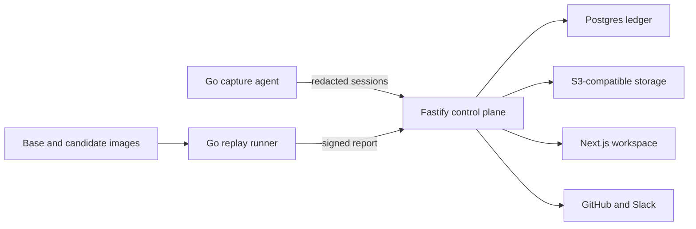

# Technology and architecture

This document records the approved stack and the constraints that keep Hyrum deterministic,
tenant-safe, and operable.

## Stack

| Area | Choice |
| --- | --- |
| Workspace | pnpm 10.33.0, Turborepo |
| Web | Next.js 16 App Router, React, TypeScript, Tailwind CSS, shadcn/ui |
| API | Node.js 22, Fastify 5, Zod, REST, OpenAPI 3.1 |
| Capture and replay | Go 1.24+ |
| Database | PostgreSQL 16+, Drizzle, explicit SQL migrations |
| Jobs | Postgres queue and transactional outbox |
| Human identity | WorkOS AuthKit |
| Machine identity | Scoped Hyrum tokens stored as Argon2id hashes |
| Object storage | Cloudflare R2 through S3 API; MinIO locally |
| AI | OpenAI Responses API, GPT-5.6, Structured Outputs |
| Integrations | GitHub App with Octokit; Slack with Bolt |
| Progress | Server-Sent Events |
| Observability | Pino, OpenTelemetry, Grafana Cloud, Sentry |
| Local and CI isolation | Docker Compose, WireMock |

Do not add Redis. Postgres is the approved job and outbox foundation.

## System flow



## Trust boundaries

- Redaction happens in capture before network egress.
- Deterministic Go extractors own behavior identity, evidence eligibility, replay normalization, and
  gate inputs.
- Capture and replay import the same extractor package.
- GPT output is advisory and schema-validated. It cannot set evidence or gate status.
- Every tenant-owned boundary receives `organization_id` explicitly.
- Postgres RLS contains query mistakes but does not replace application authorization.
- Workers use a dedicated non-superuser role and re-enter an explicit tenant transaction for
  handler work.

## Repository layout

```text
apps/web                 Next.js workspace
apps/control-plane       Fastify API, auth, webhooks, and SSE
apps/worker              Jobs and transactional outbox
packages/contracts       Zod request, response, and event schemas
packages/api-client      Generated OpenAPI client
packages/db              Drizzle schema, migrations, repositories
packages/storage         S3-compatible object storage
packages/openai          Prompts, schemas, fallbacks, and evals
packages/integrations    GitHub and Slack delivery
cmd/hyrum-agent          Capture and redaction binary
cmd/hyrum-replay         Differential replay binary
internal                 Shared deterministic Go packages
demo                     Reproducible e-commerce scenario
fixtures                 Labeled traffic and replay corpora
infra                    Local and deployment configuration
```

Do not duplicate extractor logic in TypeScript. TypeScript services consume signed reports or invoke
the pinned Go binary where needed.

## Web

- Use Server Components for initial read-heavy views.
- Keep interactive mutations and progress updates in small client components.
- Use the generated OpenAPI client for server-side control-plane calls.
- Render generated prose as untrusted text or sanitized Markdown with links disabled by default.
- Meet WCAG 2.1 AA and preserve the complete review flow on phones and tablets.
- Use semantic theme tokens from `globals.css`; do not introduce a parallel design system.

## API

- Public product routes use `/v1`.
- Validate requests, responses, and machine payloads with Zod. Reject unknown ingestion fields.
- Use cursor pagination with stable `(created_at, id)` ordering.
- Return RFC 9457 problem details and a request ID.
- Verify webhook signatures against the raw body before parsing.
- Keep internal routes on private networking.

Capture ingestion is idempotent by tenant, agent, and batch. Return item-level failures rather than
retrying a valid batch.

## Data

Core tables cover organizations, memberships, agents, API specs and operations, consumers, capture
sessions, behaviors and observations, receipts, claims, ledger entries, assertions, replay corpora
and runs, gate policies and decisions, model runs, jobs, outbox records, integrations, and audit
events.

Rules:

- Tenant-owned indexes begin with `organization_id` where practical.
- Behavior fingerprints use SHA-256 over canonical JSON and extractor version.
- Large redacted artifacts live in object storage; Postgres stores metadata, digests, and small
  excerpts.
- Database constraints enforce enums, lifecycle invariants, and valid references.
- State changes and required notifications commit with an outbox row in one transaction.
- Migrations are generated, reviewed, committed, and applied forward.

## Capture

The Go agent reads NDJSON or proxied demo traffic, groups complete consumer sessions, applies
sampling, redacts sensitive content, extracts fingerprints, and sends bounded batches.

- Use tenant-keyed HMAC for consumer identity and structural equality.
- Preserve sequence offsets, completeness, redaction version, and extractor version.
- Bound memory, retries, spool size, and request timeouts.
- Fail open for customer traffic: observation failure cannot interrupt the API.
- Remote OpenAPI references are disabled by default to prevent SSRF.

## Replay

The Go runner starts base and candidate images in isolated Docker networks, applies identical
fixtures and stubs, sends the same corpus, masks nondeterminism, repeats deltas, and emits a signed
report.

- Require immutable image digests.
- Disable public egress by default.
- Use explicit allowlists and reject private, link-local, and metadata targets outside the managed
  replay network.
- Require disposable data and stubs for writes.
- Quarantine unstable deltas; they may warn but cannot block.
- Verify Ed25519 signatures and recompute policy decisions in the control plane.

## Authentication and authorization

WorkOS supplies user identity and organization context. Hyrum stores membership and permissions.
Roles are `owner`, `admin`, `engineer`, and `viewer`; APIs authorize explicit actions.

Capture agents and CI runners use scoped, expiring Hyrum credentials. Store only Argon2id hashes.
Request GitHub installation tokens only when needed and never persist them in plaintext.

## AI

Use the official OpenAI SDK with the Responses API and Structured Outputs. Store model name,
prompt/schema version, response ID, token usage, and result digest. Set `store: false` where required
by the data policy.

Supported advisory tasks:

- behavior clustering and naming;
- evidence-tier proposals with cited receipts;
- replay-corpus prioritization;
- consumer-impact explanations;
- OpenAPI change drafts;
- customer notices.

The deterministic validator may reject or downgrade output. It may never promote unsupported
evidence to T1.

## Jobs and integrations

Workers claim bounded batches with `FOR UPDATE SKIP LOCKED`. Handlers are idempotent and identified
by an explicit job type. The outbox delivers GitHub checks, Slack messages, and progress events after
commit.

Delivery destinations come from active tenant-owned integration mappings. Workers re-read the
mapping before sending and never trust a queued raw destination.

Use SSE for one-way progress. WebSockets are not required.

## Security and operations

- Never log bodies, credentials, cookies, signed URLs, or full prompts.
- Encrypt data in transit and at rest. Keep production database TLS in full-verification mode.
- Use least-privilege service identities and separate control-plane, worker, migration, and CI
  credentials.
- Keep object keys tenant-prefixed and content-addressed.
- Apply size, digest, timeout, rate, and concurrency limits at every external boundary.
- Send traces and structured logs through OpenTelemetry; use Sentry for application errors.
- Alert on ingestion rejection, queue lag, replay failure, signature rejection, and delivery
  failure.

## Verification and delivery

```bash
pnpm verify
pnpm test:e2e
pnpm demo:acceptance
pnpm test:resilience
```

`pnpm verify` runs formatting, lint, strict TypeScript, package and demo tests, migration and OpenAPI
checks, production builds, Go tests, vet, and binary builds.

CI uses short-lived branches, protected `main`, conventional commits, and GitHub Actions. Production
promotion requires green verification, migration review, deployment smoke checks, and a rollback
path.

## Current scope

The current product includes the web workspace, control plane, worker, NDJSON capture agent,
isolated replay runner, deterministic demo, generated API client, GitHub and Slack integrations, and
deployment configuration.

Deferred:

- Kafka, Redis, Kubernetes, and distributed Postgres;
- hosted execution of arbitrary customer images;
- native Kong and Envoy integrations;
- internal service-mesh support;
- timing and latency contracts.

See [Remaining work](PENDING.md) for production-pilot gaps.
