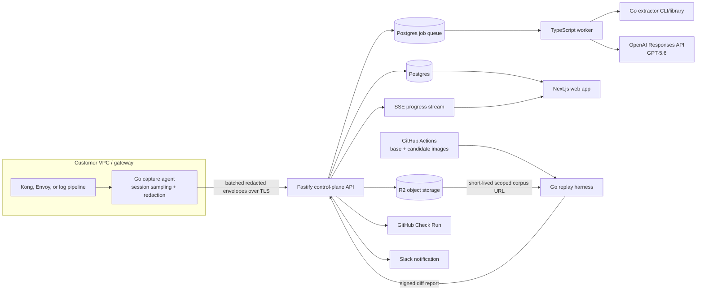

# Hyrum — Technology Stack and Engineering Plan

**Status:** Proposed implementation baseline  
**Source of truth:** [`PRD.md`](./PRD.md), revision 2, 2026-07-14  
**Target:** OpenAI hackathon vertical slice with a production-capable path  
**Required development model:** Codex with GPT-5.6 (`gpt-5.6`)

## 1. Executive decision

Hyrum should be built as a small polyglot monorepo with two deliberately different execution planes:

1. A **TypeScript control plane** for the web application, API, jobs, integrations, and OpenAI calls. This optimizes hackathon speed, shared types, and product iteration.
2. A **Go data plane** for capture, redaction, fingerprint extraction, and differential replay. These components run near customer traffic or inside CI, must be portable single binaries, and must produce deterministic results independent of the LLM.

The first hosted deployment uses **Vercel** for the Next.js application, **Fly.io** for the long-running API and worker containers, **Neon Postgres**, and **Cloudflare R2**. The replay harness runs in the customer's **GitHub Actions** job so base and candidate images, fixtures, and traffic do not have to leave CI. Local development uses Docker Compose substitutes for Postgres, object storage, and test services.

This is not a microservice fleet. For the hackathon there are only four deployable artifacts:

- `web`: Next.js user interface.
- `control-plane`: Fastify API, including ingestion endpoints and GitHub/Slack webhooks.
- `worker`: the same TypeScript packages in a Postgres-backed job worker process.
- `hyrum-agent` / `hyrum-replay`: Go binaries, built from shared extractor packages.

The architecture preserves the PRD's most important trust boundary: **deterministic code measures behavior and applies policy; GPT-5.6 propo`ses labels, evidence tiers, corpus priorities, and prose, but can never create a blocking fact by itself.**

## 2. Requirement-to-stack traceability

| PRD requirement | Stack response |
|---|---|
| Per-consumer accidental-contract ledger | Postgres relational model with JSONB fingerprints, evidence receipts, freshness, and lifecycle fields |
| Session-correlated capture | Go capture agent groups by tenant, consumer, and configurable time window; low-volume sampling boost is deterministic |
| Redaction before egress | Redaction and keyed structural hashing occur in the customer-side Go agent; raw values are never sent to the SaaS control plane |
| Shape, ordering, and error behaviors | Shared versioned Go extractor library used identically by capture and replay |
| T1 echo evidence | Sequence-preserving samples plus deterministic hashed-value provenance matching across response-to-subsequent-request edges |
| T2 and T3 evidence | SQL/worker statistics plus GPT-5.6 candidate classification; policy engine prevents T2/T3 from blocking |
| OpenAPI spec subtraction | `@apidevtools/swagger-parser`, `openapi-types`, and a normalization layer in the control plane |
| Differential replay | Go/Docker runner launches base and candidate builds, replays the same corpus, masks nondeterminism, and emits a signed machine-readable report |
| GitHub change gate | GitHub App plus reusable GitHub Action; Check Run conclusion comes only from deterministic report and repository policy |
| Assertion expiry | Postgres assertions plus scheduled database jobs and Slack/email reminders |
| Redacted samples and corpus with TTL | S3-compatible R2 lifecycle policies plus application-level expiry metadata |
| Live hackathon demo | Server-Sent Events for ingestion/replay progress and pre-generated 50k-request NDJSON fixtures |
| Precision, recall, replay stability | Versioned labeled corpus, deterministic eval CLI, repeated replay runs, and CI metrics |

## 3. System architecture



### Data ownership and trust boundaries

- Raw traffic stays inside the customer environment. The capture agent emits only normalized fingerprints, keyed hashes, and explicitly allowed redacted receipts.
- Tenant data is separated by `organization_id` on every control-plane table. Postgres row-level security is defense in depth; application authorization remains mandatory.
- Replay executes untrusted customer images in an isolated CI job or dedicated runner, never in the web/API process.
- OpenAI receives only the minimum redacted fingerprint diffs and receipt excerpts needed for the task. It does not receive raw API keys, authorization headers, cookies, or unredacted payloads.
- A model result is data with provenance (`model`, prompt version, response ID, schema version), not an authoritative gate decision.

## 4. Repository and language strategy

### Selected: pnpm workspace, Turborepo task runner, TypeScript 5.x, Go 1.24+

**Purpose.** Keep product code, shared contracts, demo fixtures, Go binaries, infrastructure, and GitHub Action code in one repository while preserving clear package boundaries.

**Why this fits.** TypeScript maximizes shared implementation speed across UI, API, workers, SDKs, and integrations. Go is a strong fit for a low-footprint customer-side agent and deterministic, concurrent replay runner: static binaries, predictable resource usage, mature HTTP/JSON libraries, and straightforward cross-compilation. Turborepo only coordinates builds/tests; it does not impose runtime architecture.

**Alternatives considered.** An all-TypeScript stack would reduce languages but makes distribution of a capture sidecar and high-concurrency replay runner less clean. An all-Go backend would slow UI/integration work. Rust offers excellent performance and safety but has higher hackathon implementation cost. Nx is more feature-rich than needed.

**Implementation notes and trade-offs.** Keep the algorithmic behavior specification in language-neutral JSON fixtures. Do not duplicate extractor logic in TypeScript: TypeScript jobs shell out to the pinned Go CLI/container. Suggested layout:

```text
apps/web                 Next.js application
apps/control-plane       Fastify HTTP API and webhooks
apps/worker              Postgres job processors and schedulers
packages/contracts       Zod schemas, generated clients, event schemas
packages/db              Drizzle schema, SQL migrations, repositories
packages/openai          prompts, Structured Output schemas, evals
packages/integrations    GitHub and Slack adapters
cmd/hyrum-agent          Go capture/redaction binary
cmd/hyrum-replay         Go replay binary
internal/extractors      Shared deterministic Go extractors
internal/redaction       Capture-side rules and keyed hashing
demo/api                 Eight-endpoint e-commerce API
demo/consumers           Three explicitly scripted consumers
fixtures                 Labeled traffic and replay/eval corpora
infra                    Docker Compose and deployment configuration
```

## 5. Frontend architecture

### Selected: Next.js 16 App Router, React, TypeScript, Tailwind CSS, shadcn/ui

**Purpose.** Deliver the ledger, endpoint and consumer drill-downs, receipt viewer, replay results, assertion lifecycle, policy settings, and live demo progress.

**Why this fits.** Next.js supports authenticated server-rendered product pages, route-level loading/error states, and a mature Vercel deployment path. React and shadcn/ui enable fast construction without locking core product UI into a proprietary component library. Server Components are useful for read-heavy ledger screens; interactive evidence review remains in small client components.

**Alternatives considered.** Remix is strong for data mutations but offers less team familiarity and ecosystem leverage for this timeline. A Vite SPA is simpler but would require a separate auth-aware backend-for-frontend and more client state. Material UI accelerates basic screens but is harder to shape into a distinctive dense developer-tool interface.

**Implementation notes and trade-offs.**

- Use Server Components for initial ledger and assertion data. Use TanStack Query only for interactive polling/mutations, not as a second global state store.
- Use TanStack Table for sortable/filterable ledger grids and `react-diff-viewer` or a small custom semantic diff component for receipts. Do not display raw JSON by default.
- Use Recharts only for precision/recall, freshness, and replay-stability summaries. Avoid a general dashboard chart framework.
- Use React Hook Form plus Zod for policy, assertion, and onboarding forms.
- Meet WCAG 2.1 AA: keyboard-accessible evidence drawers, semantic status labels in addition to color, and copyable redacted receipts.
- Treat generated prose as untrusted text; render it as escaped text or sanitized Markdown with links disabled by default.

### State and API client

Generate a typed TypeScript client from the control-plane OpenAPI document using `openapi-typescript` and `openapi-fetch`. Server-side calls use the same client with an organization-scoped auth token. This prevents UI/API contract drift without adopting GraphQL.

## 6. Backend and API design

### Selected: Node.js 22 LTS, Fastify 5, TypeScript, Zod, REST/JSON, OpenAPI 3.1

**Purpose.** Provide tenant-scoped product APIs, batched capture ingestion, corpus management, replay report ingestion, GitHub and Slack webhooks, and SSE progress feeds.

**Why this fits.** Fastify has low overhead, schema-driven validation, good plugin boundaries, streaming support, and fewer framework abstractions than NestJS. REST maps cleanly to Hyrum's resources and GitHub Action integration. OpenAPI is also native to the problem domain and allows the team to dogfood its own spec handling.

**Alternatives considered.** NestJS provides stronger conventions but adds decorators and module ceremony. tRPC is fast for a TypeScript-only application but is a poor public API and agent integration boundary. GraphQL is unnecessary for the current resource model and complicates authorization, caching, and auditability. Python/FastAPI is attractive for ML-heavy systems, but Hyrum's core analysis is deterministic and the team benefits more from shared TypeScript contracts.

**Implementation notes and trade-offs.**

- Namespace public APIs under `/v1`; expose `/internal` only on private networking.
- Validate every body, query, and response. Reject unknown fields on machine-to-machine ingestion schemas.
- Capture ingestion is idempotent using `tenant_id + agent_id + batch_id`; return per-item acceptance errors rather than retrying an entire batch.
- Use cursor pagination with stable `(created_at, id)` ordering.
- Use RFC 9457 problem details for API errors and a request ID on every response.
- GitHub and Slack webhooks must verify signatures against the exact raw request body before JSON parsing.
- SSE is selected for one-way ingestion/replay progress. WebSockets are not required by the PRD and would add stateful infrastructure.

## 7. Database and data model

### Selected: PostgreSQL 16+ on Neon, Drizzle ORM plus explicit SQL migrations

**Purpose.** Store organizations, users, consumers, endpoint identities, behavior fingerprints, evidence, ledger entries, assertions, replay runs, policies, integrations, and audit events.

**Why this fits.** Hyrum's data has strong relationships, lifecycle transitions, tenant scoping, and transactional updates. PostgreSQL also supplies JSONB, range/date operations, full-text search, trigram indexes, advisory locks, partitioning, and row-level security. Drizzle keeps TypeScript types while allowing the SQL needed for partitions, partial indexes, and analytics.

**Alternatives considered.** Prisma is excellent for CRUD speed but less comfortable for partitioning, RLS, and SQL-heavy analysis. DynamoDB fits high-volume ingestion but complicates relational ledger queries and hackathon operations. ClickHouse may later help raw aggregate analytics but is premature while redacted sample volume is bounded and fingerprints are already aggregated. MongoDB weakens relational integrity without a compensating benefit.

### Core relational model

| Table | Key fields and notes |
|---|---|
| `organizations` | tenant, retention policy, region, status |
| `users`, `memberships` | external auth subject, organization role |
| `agents` | hashed credential ID, version, last seen, config revision |
| `api_specs`, `operations` | immutable spec versions; normalized method/path/operation ID |
| `consumers` | opaque stable ID and display alias; never store the original API key |
| `capture_sessions` | consumer, start/end, sample policy version, sequence completeness |
| `behavior_definitions` | canonical deterministic fingerprint, kind, extractor version, declared/undeclared status |
| `behavior_observations` | operation, consumer, behavior, counts, first/last seen; time-partitioned |
| `receipts` | object key, redaction version, sequence offsets, digest, expiry |
| `dependency_claims` | behavior + consumer, T1/T2/T3, evidence, confidence metadata, human override |
| `ledger_entries` | claim state, freshness, owner, review state; denormalized read model where useful |
| `assertions` | behavior, owner, reason, policy, expiry, resolution |
| `replay_corpora`, `corpus_items` | immutable corpus version and coverage class; body stored in object storage |
| `replay_runs`, `replay_deltas` | base/candidate digests, extractor/config versions, stable delta, matched claims |
| `gate_policies`, `gate_decisions` | versioned policy and deterministic decision trace |
| `llm_runs` | task, model, prompt/schema version, OpenAI response ID, token usage, result digest |
| `audit_events` | append-only actor/action/resource/change metadata |

### Modelling rules

- Every tenant-owned primary/unique index begins with `organization_id` where practical.
- Fingerprints are content-addressed with SHA-256 over canonical JSON plus extractor version. Never use an LLM-generated label as identity.
- Store large samples and corpus bodies in object storage; Postgres stores only metadata, hashes, small masked excerpts, and indexes.
- Partition `behavior_observations` and `audit_events` monthly. Start without distributed Postgres.
- Mark a behavior stale when `last_seen_at < now() - interval '90 days'`; retain history rather than deleting ledger state.
- Use database constraints for tier enum, assertion expiry, allowed state transitions where feasible, and only one active human override per claim.
- Use transactions/outbox rows for state changes that must trigger jobs or notifications. Workers publish from the outbox after commit.

## 8. Authentication and authorization

### Selected: WorkOS AuthKit for people; scoped Hyrum credentials for machines

**Purpose.** Authenticate web users quickly, support organization membership, and separately authenticate capture agents, CI runners, and GitHub installations.

**Why this fits.** WorkOS AuthKit supplies hosted sign-in, organization context, MFA, and a direct path to enterprise SSO/Directory Sync without making the identity provider authoritative for product permissions. Machine identities need narrower, revocable credentials than browser sessions, so they remain first-party.

**Alternatives considered.** Clerk is polished and fast but offers less advantage for Hyrum's enterprise developer-platform buyer. Auth0 is mature but heavier. Auth.js requires more organization, invitation, MFA, and enterprise provisioning work. Using one shared API key for all agents is unacceptable.

**Implementation notes and trade-offs.**

- Roles: `owner`, `admin`, `engineer`, `viewer`; permissions are explicit actions such as `assertion:pin`, `claim:override`, and `integration:manage`.
- Store only Argon2id hashes of agent tokens. Tokens carry an ID prefix for lookup, tenant, scopes, expiry, and rotation metadata.
- GitHub App installation tokens are requested just in time and never persisted in plaintext.
- Require recent reauthentication for destructive integration changes and claim promotion/demotion.
- Add Postgres RLS as a containment layer, but do not rely on RLS alone for authorization.

## 9. Capture, redaction, and document processing

### Selected: Go capture agent with adapter interfaces and CEL-based policy rules

**Purpose.** Accept events from gateway/log sources, correlate consumer sessions, redact PII/secrets inside the VPC, compute initial fingerprints, and batch encrypted envelopes to the control plane.

**Why this fits.** A small Go binary is easy to run as a sidecar, DaemonSet, or container. CEL (Common Expression Language) provides a constrained, auditable configuration language for allow/deny/redact rules without executing arbitrary code.

**Alternatives considered.** Native Kong Lua and Envoy C++ filters give deeper integration but double implementation effort. A WASM filter is a promising later distribution form, but cross-gateway behavior and debugging add hackathon risk. OpenTelemetry Collector extensions are attractive for log-pipeline environments but do not alone solve sequence capture and response-body redaction.

**Implementation notes and trade-offs.**

- Hackathon adapter: NDJSON/HTTP batch input plus a small reverse-proxy demo mode. Production adapters: Kong log plugin, Envoy access-log service, and S3/Kafka log tap.
- Derive `consumer_id` from an HMAC of the configured API-key/client-ID value; discard the source credential immediately.
- Always remove authorization, cookies, tokens, multipart bodies, configured sensitive paths, and binary payloads before buffering.
- Structural hashing uses a tenant-derived HMAC key, not an unsalted hash, to prevent dictionary attacks while preserving within-tenant equality required for T1 echo detection.
- A session key is consumer + configured correlation ID when present, otherwise consumer + bounded time window. Sequence numbers and completeness flags are preserved.
- Use bounded memory queues, compressed batches, exponential backoff, a disk spool with encryption and byte cap, and fail-open observation: capture failure must never interrupt customer traffic.
- Version redaction and extractor configs. Receipts must show exactly which versions produced them.

### Selected OpenAPI processing: `@apidevtools/swagger-parser`, `openapi-types`, Ajv

**Purpose.** Parse and dereference OpenAPI 3.x documents, normalize operations/schemas, and subtract declared behavior from observations.

**Why this fits.** These libraries cover validation and reference resolution while keeping Hyrum's semantic subtraction logic explicit and testable.

**Alternatives considered.** Redocly CLI is excellent for linting and bundling but is heavier as an embedded library. Speakeasy and oasdiff solve neighboring declared-spec problems rather than Hyrum's observed-behavior ledger.

**Implementation notes and trade-offs.** Save the original spec and a normalized immutable representation. Resolve `$ref` safely with remote fetch disabled by default to avoid SSRF. Canonicalize path templates and media types. Treat nullable, optional, and absent as distinct according to the OpenAPI version.

## 10. Deterministic behavior extraction and dependency inference

### Selected: versioned Go extractor library and explicit rules engine

**Purpose.** Extract response shape, presence/absence/null, primitive types, observed enum-like values, undocumented fields, paginated ordering, and status/error templates; infer provable T1 echoes; normalize the same fields during replay.

**Why this fits.** One shared implementation removes capture-versus-replay semantic drift. A canonical JSON representation makes results reproducible and content-addressable. The rules engine encodes the PRD's evidence-tier definitions and policy boundary.

**Alternatives considered.** JSON Schema diff libraries do not operate on sequences or observed behavior. LLM extraction would be nondeterministic and violate the gate design. Apache Flink/Kafka Streams could process enormous streams but are unjustified for the vertical slice.

**Implementation notes and trade-offs.**

- Canonicalize JSON object keys, preserve arrays, classify absent separately from null, and cap high-cardinality observed values.
- Normalize error templates deterministically by replacing configured/recognized UUIDs, timestamps, numeric IDs, and hashes. Keep the normalized template plus digest.
- Detect ordering only where pagination context exists; compare stable key sequences across pages. Timing is intentionally excluded.
- T1 requires a response-only keyed hash to appear in a later request from the same complete session. Save both sequence positions and JSON paths as the receipt.
- T2 candidates are statistical associations with minimum sample/support thresholds and explicit confounder notes. T2 never blocks.
- T3 is exposure count only. The label “dependency” must not be used for T3 in UI or API responses.
- Human overrides never rewrite raw evidence; they create auditable superseding decisions.

## 11. Differential replay harness

### Selected: Go CLI, Docker Engine API, Compose-compatible fixture contract, WireMock

**Purpose.** Start base and candidate API images in isolation, seed disposable dependencies, replay identical curated requests, mask nondeterminism, compare observable results, rerun for stability, and emit a signed JSON report.

**Why this fits.** Docker is already an ICP prerequisite. A standalone Go CLI works locally and in GitHub Actions, keeps orchestration close to the builds, and allows deterministic concurrency and timeouts. WireMock provides explicit stubs for outbound side effects without pretending onboarding is automatic.

**Alternatives considered.** Kubernetes Jobs are too heavy for hackathon CI. Testcontainers is excellent inside a test suite but Hyrum needs a distributable product CLI and stable report protocol. A Hyrum-hosted runner improves convenience later but increases data residency, untrusted-code, and cost risk.

**Implementation notes and trade-offs.**

- Address images by immutable digest. Record runner, extractor, corpus, mask, fixture, and policy versions in every report.
- Run base and candidate on separate internal networks with identical fixture seeds and stub mappings. Disable public egress by default.
- Default to safe read endpoints. Writes require an explicit disposable database and stub declaration.
- Apply per-request deadlines and global resource limits. Never mount the Docker socket into a public control-plane service.
- Replay corpus selection is deterministic by endpoint × consumer × behavior-class coverage. GPT-5.6 may rank slices, but the selected set and reason are recorded, and pinned assertions are always included.
- Run changed cases at least twice; quarantine a delta when repeated outputs do not agree. A quarantined/flaky endpoint warns and cannot produce a block until stable.
- Sign the report with an ephemeral CI credential and verify it server-side. The GitHub Check Run includes base/candidate digests and direct links to receipts.

## 12. AI and OpenAI integration

### Selected: OpenAI Responses API, official `openai` Node SDK, GPT-5.6 family, Structured Outputs

**Purpose.** Cluster/name already extracted behaviors, propose evidence tiers from fingerprint diffs and cited sequences, prioritize optional replay slices, explain deterministic impact, draft OpenAPI changes, and draft customer notices.

**Why this fits.** GPT-5.6 is the required model family and supports the Responses API and Structured Outputs. The Responses API is the forward path for stateful/tool-capable OpenAI applications; Hyrum primarily uses stateless, schema-constrained calls. Structured Outputs provides machine-validated results that can be rejected safely when incomplete.

**Model policy.**

- Use `gpt-5.6-terra` with low or medium reasoning for nightly clustering and evidence proposals: it is the balanced default for repeatable analysis.
- Use `gpt-5.6` (the Sol alias) with medium reasoning for high-value PR impact explanations, spec drafts, and ambiguous cases.
- Optionally use `gpt-5.6-luna` only after evals show it preserves quality for high-volume naming/classification.
- Pin a dated snapshot when OpenAI exposes one suitable for production reproducibility; keep aliases in local/hackathon configuration for access simplicity.

**Alternatives considered.** Embeddings plus vector clustering are unnecessary because fingerprints and echo relations are structured. The Agents SDK would add orchestration Hyrum does not need. Fine-tuning is premature before feedback data exists. Chat Completions is not selected because Responses is the current API direction.

**Implementation notes and trade-offs.**

- Define Zod/JSON Schemas for every model task. Results must include candidate tier, cited receipt IDs/sequence offsets, rationale, uncertainty, and abstention reason.
- The deterministic validator recomputes tier eligibility. It can downgrade or reject an LLM proposal; it can never promote unsupported evidence to T1.
- Never give the model a tool that can set gate status. Gate policy consumes only signed replay deltas and persisted human/rule decisions.
- Strip secrets and unnecessary values before prompts. Set API data retention controls appropriate to the customer's agreement and document subprocessors.
- Use bounded retries only for transient failures, exponential backoff, idempotency keys where supported, timeouts, and a circuit breaker. Model failure leaves deterministic extraction/replay usable with generic labels.
- Cache by task type + canonical input digest + prompt/schema/model version. Use Batch API for non-urgent nightly classification when operationally available; keep PR explanations synchronous with a strict timeout and template fallback.
- Store prompt versions and eval them before rollout. Do not log full prompt payloads; store redacted digests and approved samples.
- Official references: [GPT-5.6 Sol](https://developers.openai.com/api/docs/models/gpt-5.6-sol), [Structured Outputs](https://developers.openai.com/api/docs/guides/structured-outputs), and [Batch API](https://developers.openai.com/api/docs/guides/batch).

### Codex 5.6 development setup

All hackathon development should run Codex with GPT-5.6. Select it interactively or use:

```bash
codex --model gpt-5.6
codex exec -m gpt-5.6 "Run the repository verification suite and review the diff"
```

The team may set `model = "gpt-5.6"` in personal Codex configuration, but repository behavior belongs in a checked-in `AGENTS.md`, not in personal config. `AGENTS.md` should define build, lint, test, fixture regeneration, deterministic replay, and secret-handling rules. Do not commit API keys or user-specific Codex configuration.

## 13. Object storage, retention, and retrieval

### Selected: Cloudflare R2 using the S3 API; MinIO locally

**Purpose.** Store redacted receipt bundles, immutable replay corpora, uploaded OpenAPI documents, and generated reports too large for Postgres.

**Why this fits.** R2 is S3-compatible, inexpensive for demo retrieval, and simple to access from Fly.io and GitHub Actions. The S3 interface preserves portability. MinIO supplies a close local substitute.

**Alternatives considered.** AWS S3 is the strongest enterprise default and an easy future deployment target, but using AWS only for storage adds setup during the hackathon. Postgres large objects increase database cost and backup burden. Vercel Blob is convenient for the UI but less natural for agent/CI S3 workflows.

**Implementation notes and trade-offs.**

- Use tenant-prefixed, opaque object keys and server-side encryption. Never derive paths from consumer input.
- Issue short-lived, read-only signed URLs for a single replay corpus/report. UI downloads should pass an authorization check before URL issuance.
- Apply lifecycle deletion at the bucket level and independently enforce `expires_at` in Postgres. Default receipts/corpus to 30 days unless tenant policy is shorter; assertion metadata survives object expiry.
- Hash every object on upload and verify before replay. Use immutable corpus version IDs rather than overwriting objects.

## 14. Search and indexing

### Selected: PostgreSQL full-text search plus `pg_trgm`

**Purpose.** Search ledger entries by endpoint, consumer alias, behavior label, error template, owner, status, tier, and freshness.

**Why this fits.** The search domain is structured and tenant-scoped. PostgreSQL search and trigram indexes cover the expected scale without another data store or synchronization pipeline.

**Alternatives considered.** Elasticsearch/OpenSearch provides sophisticated ranking but adds cost and eventual consistency. Meilisearch is simpler but still duplicates tenant data. Vector search does not improve exact endpoint, error-template, or lifecycle queries.

**Implementation notes and trade-offs.** Build a generated `tsvector` over approved redacted text only, combine it with indexed structured filters, and always include `organization_id`. Revisit OpenSearch only after query latency or corpus scale is measured to exceed Postgres capacity.

## 15. Background jobs and workflow orchestration

### Selected: Postgres job queue and transactional outbox

**Purpose.** Run fingerprint aggregation, dependency inference, OpenAI batches, freshness downgrades, assertion reminders, retention cleanup, integration retries, and demo progress events.

**Why this fits.** Hyrum already requires always-on API/worker containers and Postgres. A first-class job table plus transactional outbox keeps scheduling, leases, retries, and product state in one durable system without Redis or another workflow vendor.

**Alternatives considered.** Temporal is excellent for long-running workflows but adds a service, SDK concepts, and operational overhead. Trigger.dev and Inngest speed hosted jobs but add a vendor Hyrum does not need. SQS/EventBridge is a good AWS production alternative but less ergonomic locally. Redis/BullMQ duplicates durable state and recovery machinery already required in Postgres.

**Implementation notes and trade-offs.** `jobs` stores type, tenant, payload reference, status, `run_after`, attempts, lease owner/expiry, and idempotency key. Workers claim bounded batches with `FOR UPDATE SKIP LOCKED`, renew leases, apply exponential backoff, and move exhausted jobs to a dead-letter state. Use per-tenant concurrency limits to prevent noisy-neighbor OpenAI or analysis usage. Nightly schedulers enqueue tenant jobs; replay itself stays in CI. Revisit a dedicated queue only when measured contention or queue latency harms transactional SLOs.

## 16. GitHub, Slack, and real-time communication

### Selected: GitHub App, reusable composite/Docker Action, Octokit

**Purpose.** Receive pull request events, exchange short-lived runner credentials, publish Check Runs, and link deterministic replay evidence.

**Why this fits.** A GitHub App has granular repository permissions and installation-scoped tokens. A reusable Action lets the customer control Docker builds, fixtures, and secrets.

**Alternatives considered.** A personal access token is inappropriate for a multi-tenant product. A pure CI script cannot provide installation UX or rich Check Runs. GitHub Marketplace packaging can wait until the workflow stabilizes.

**Implementation notes and trade-offs.** Request only Checks read/write, Pull Requests read, Contents read, and Metadata read. Pin third-party Actions by commit SHA. Use OIDC or a one-use exchange token instead of a permanent Hyrum secret where possible. Fork PRs must not receive protected secrets.

### Selected: Slack app via Bolt for JavaScript

**Purpose.** Notify teams about blocked/warned PRs, expiring assertions, and review actions.

**Why this fits.** Bolt handles Slack signatures and interaction payloads with minimal code. Slack is a notification/review surface, not a source of truth.

**Alternatives considered.** Incoming webhooks are quicker but cannot support scoped interactive review safely. Email remains a later fallback.

**Implementation notes and trade-offs.** Store encrypted bot tokens, verify signatures, make actions idempotent, and deep-link to the authenticated web app for sensitive receipts. Do not put receipt bodies in Slack.

### Selected real-time transport: Server-Sent Events

SSE is sufficient for one-way live capture/replay/job progress in the demo and product. It works through ordinary HTTP infrastructure and reconnects automatically. WebSockets, Socket.IO, and a hosted pub/sub product are deferred until a true bidirectional collaboration feature appears.

## 17. Hosting and infrastructure

### Selected hackathon deployment

| Component | Service | Reason |
|---|---|---|
| Web | Vercel | First-class Next.js deployment and preview environments |
| API and worker | Fly.io Machines | Long-running Docker processes, SSE, regional placement, simple scaling |
| Database | Neon Postgres | Managed Postgres, branching for previews/tests, no database operations burden |
| Object storage | Cloudflare R2 | S3-compatible storage with lifecycle rules |
| Jobs | Neon Postgres | Durable job table and outbox in the existing system of record |
| Replay | GitHub-hosted or customer self-hosted Actions runner | Keeps images, fixtures, and write-path data in CI |
| DNS/TLS/WAF | Cloudflare | Managed TLS, DNS, coarse rate limiting and WAF |

**Why this fits.** It keeps each runtime on infrastructure suited to it and avoids operating Kubernetes or a second stateful queue during a hackathon. Stateful interfaces remain portable Postgres and S3 APIs.

**Alternatives considered.** A single Railway/Render deployment is slightly simpler but gives less control over runner/data-plane placement. AWS ECS/RDS/S3/ElastiCache is the expected enterprise consolidation path but requires substantially more initial infrastructure. Kubernetes is not justified until tenant isolation, custom regions, or sustained workload scheduling requires it.

**Implementation notes and trade-offs.**

- Define infrastructure with Pulumi TypeScript after the vertical slice; use checked-in declarative service config before then. Do not spend the first hackathon day building a platform.
- Keep API and worker images identical with different start commands. Enable zero-downtime API deployment and graceful job shutdown.
- Use connection pooling appropriate for Neon; cap each process pool and use pooled URLs for serverless web access.
- Backups/PITR are enabled for Postgres. Object lifecycle deletion and job lease recovery are tested.
- Production enterprise option: deploy the same containers on AWS ECS Fargate, RDS Postgres Multi-AZ, S3, ElastiCache, KMS, Secrets Manager, and private networking. This is a deployment profile, not a hackathon prerequisite.

## 18. Security, privacy, and secrets

### Selected controls

- **Secrets:** 1Password CLI for local team sharing; Vercel/Fly/Neon/R2/WorkOS managed secrets in hosted environments; GitHub Environments and OIDC for CI. Never commit `.env` files.
- **Encryption:** TLS 1.2+ in transit, provider-managed encryption at rest, envelope encryption/KMS for integration tokens, and tenant-derived HMAC keys for structural hashes.
- **Tenant isolation:** organization-scoped queries, RLS policies, object-key prefixes, scoped credentials, and authorization tests.
- **Supply chain:** lockfiles, Dependabot/Renovate, CodeQL, Semgrep, `govulncheck`, `npm audit`/OSV scanning, Trivy image scans, SBOM generation with Syft, and signed images/releases with Cosign.
- **Application security:** strict CSP, secure cookies, CSRF protection where cookie auth is used, SSRF-safe OpenAPI loading, body limits, rate limits, webhook signature verification, and output escaping.
- **Auditability:** append-only audit events for claim overrides, assertion changes, integration changes, corpus access, and gate decisions.
- **Privacy:** configurable field policy, raw-body opt-out, regional retention, TTL deletion, data export/deletion workflows, and a documented subprocessors list.

**Why this fits.** Traffic capture is the highest-risk part of Hyrum. Privacy cannot be retrofitted after raw payloads reach the SaaS. Capture-side minimization and keyed structural hashes preserve the proof Hyrum needs without preserving the sensitive value.

**Alternatives considered.** Sending raw data to a centralized DLP/redaction service would simplify the agent but violate the PRD trust boundary. Hashing without a secret is vulnerable to guessing. Fully homomorphic or confidential-compute analysis is unnecessary for v1 and not hackathon-feasible.

**Important trade-off.** HMAC equality can still reveal repeated values within one tenant. Keys must be isolated per tenant and rotated with a controlled overlap period; hashes must never be comparable across tenants.

## 19. Logging, monitoring, and error tracking

### Selected: OpenTelemetry, Grafana Cloud, Sentry, Pino

**Purpose.** Provide structured application logs, distributed traces, metrics, dashboards, alerting, and actionable frontend/backend exceptions.

**Why this fits.** OpenTelemetry keeps instrumentation vendor-neutral. Grafana Cloud accepts OTLP and covers metrics/logs/traces; Sentry provides strong source-mapped product error workflows. Pino is a fast structured logger for Node.

**Alternatives considered.** Datadog is excellent but expensive for a hackathon. A Grafana/Tempo/Loki/Prometheus self-hosted stack creates operational work. Sentry alone is insufficient for queue depth, ingestion rates, and replay stability.

**Implementation notes and trade-offs.**

- Never log request/response bodies, authorization values, HMAC inputs, signed URLs, or full OpenAI prompts.
- Propagate `request_id`, `trace_id`, `organization_id`, `agent_id`, `job_id`, and `replay_run_id`; hash or omit consumer identifiers in shared telemetry.
- Primary SLO signals: ingestion acceptance/error rate, queue age, time-to-ledger, OpenAI failure/abstention rate, replay duration, stable-diff percentage, gate delivery latency, and stale-ledger count.
- Alert on sustained symptoms, not individual job retries. Add per-tenant usage/cost dashboards for storage and model calls.

## 20. Testing and evaluation strategy

### Selected tools

| Layer | Tools | What must be proven |
|---|---|---|
| TypeScript unit/component | Vitest, Testing Library | policies, API validation, UI states, authorization |
| Go unit/fuzz | `go test`, built-in fuzzing | canonicalization, masking, redaction, T1 echo matching, error templates |
| Database | Testcontainers Postgres, migration checks | constraints, RLS, repositories, partition behavior |
| API integration | Vitest + Fastify injection/Testcontainers | idempotent ingestion, webhooks, outbox/jobs |
| Browser E2E | Playwright | capture-to-ledger, receipt review, assertion lifecycle, gate report |
| Replay golden tests | Docker Compose demo images + golden JSON | base/candidate deterministic delta and masks |
| AI evals | Versioned labeled JSONL corpus | tier proposal precision/recall, citation validity, abstention, prose factuality |
| Load/resilience | k6, Toxiproxy | batch ingestion, backpressure, retries, queue recovery |
| Security | CodeQL, Semgrep, Trivy, `govulncheck`, ZAP baseline | known vulnerabilities and common web failures |

**Why this fits.** The critical product claim is empirical. Golden fixtures and labeled sequence corpora test the deterministic machinery and the model-assisted layer separately. This directly implements the PRD rule that precision without recall is prohibited.

**Implementation notes and acceptance gates.**

- Maintain planted T1 dependencies, T2 patterns, T3 exposures, and hard negatives. Report precision, recall, F1, and confusion matrices by behavior type.
- A T1 evaluation fails if either target precision is below 95% or recall regresses beyond the agreed threshold. Never optimize by predicting no dependencies.
- Run the same replay at least three times in the stability suite; stable diff target is at least 99%.
- Property/fuzz tests cover JSON depth, invalid UTF-8, huge values, duplicate headers, arrays, absent/null, timestamp/UUID masks, and adversarial secrets.
- Snapshot tests are allowed for stable UI structure, not as the primary verifier of semantic behavior.
- OpenAI prompt changes require eval comparison and human review. Store expected evidence IDs rather than expecting exact prose.

## 21. Development setup and tooling

### Required local tools

- Node.js 22 LTS managed with Volta or mise.
- pnpm via Corepack; exact version pinned in `packageManager`.
- Go 1.24+ pinned in `go.mod` and CI.
- Docker Desktop/Engine with Compose v2.
- `golangci-lint`, `gofumpt`, Biome, TypeScript, and Lefthook.
- Optional `direnv`; secrets are pulled from 1Password rather than stored in committed files.

### Selected developer tooling

- **Biome** for TypeScript formatting and fast baseline linting; **ESLint** only for framework/plugin rules Biome cannot cover.
- **golangci-lint + gofmt/gofumpt** for Go.
- **Changesets** for versioning published agent, replay CLI, Action, and SDK packages.
- **Docker Compose** for Postgres, MinIO, WireMock, demo API, and control plane.
- **Lefthook** for fast staged checks; CI remains authoritative.

**Alternatives considered.** Prettier + ESLint is ubiquitous but slower and more configuration-heavy. Nix provides stronger reproducibility but is too much adoption cost for the hackathon. Dev Containers can be added for onboarding without making them mandatory.

### Expected commands

```bash
pnpm install
docker compose up -d postgres minio wiremock
pnpm db:migrate
pnpm dev
pnpm test
pnpm test:e2e
go test ./...
pnpm demo:seed-traffic
pnpm demo:replay
pnpm verify
```

`pnpm verify` should be the single Codex/team handoff command: formatting check, lint, typecheck, Go tests, TypeScript tests, migration validation, replay golden tests, and production builds.

## 22. CI/CD and source-control workflow

### Selected: GitHub, trunk-based development, GitHub Actions

**Purpose.** Keep integration fast during the hackathon while enforcing deterministic verification and producing releasable signed artifacts.

**Why this fits.** The product already needs a GitHub App/Action, so the team can dogfood the integration. Short-lived branches and small PRs reduce merge risk.

**Alternatives considered.** GitFlow adds release branches and coordination overhead. GitLab CI would be viable but does not exercise the primary v1 integration.

**Workflow.**

1. Branch from `main`; use conventional commit messages where practical.
2. PR CI runs changed-package checks, Go and TypeScript unit/integration tests, migrations, security scans, and build.
3. Relevant changes run the Hyrum demo replay against base and candidate images. This is Hyrum dogfooding, but it is initially advisory until the golden corpus is stable.
4. Preview web deployment is created with an isolated Neon branch and non-production integrations.
5. Merge requires review and green required checks. Production deploys from `main` after smoke tests.
6. Tagged releases build multi-architecture Go binaries/images, generate SBOMs, sign artifacts, and publish checksums.

**Implementation notes and trade-offs.** Pin Actions by commit SHA, cache pnpm/Go modules, use path filters, and cancel superseded PR runs. Database migrations are forward-compatible and applied before code that requires them; destructive cleanup is a later migration. Rollback means deploying the prior image, not reversing an unsafe schema migration.

## 23. Scalability, reliability, performance, and cost

### Initial targets and tactics

- Agents upload compressed batches rather than individual requests. API ingestion writes metadata and object blobs, then queues analysis; it does not synchronously call OpenAI.
- Aggregate early by endpoint × consumer × behavior. Do not retain 50k individual rows when a fingerprint aggregate and a bounded receipt sample suffice.
- Horizontally scale stateless API and worker processes. Queue partitioning and per-tenant concurrency protect fairness.
- Partition high-growth Postgres tables, use covering/partial indexes, and inspect query plans before adding a new database.
- Object storage TTL and sample reservoir limits bound storage cost. Replay corpus uses coverage selection rather than raw volume.
- Cache stable OpenAI results and batch non-urgent calls. Apply per-tenant token budgets and generic deterministic fallbacks.
- Use request hedging nowhere by default; it can duplicate side effects and model spend.
- Job state and leases are recoverable from Postgres; an expired lease makes interrupted work claimable again.

### Failure behavior

| Failure | Required behavior |
|---|---|
| Capture agent cannot reach SaaS | Bounded encrypted spool, backoff, never affect customer response path |
| OpenAI unavailable or malformed output | Keep deterministic fingerprints/replay; show generic labels; retry async; no false block |
| Postgres temporarily unavailable | Capture agents spool with bounds; API/workers stop accepting or claiming work and resume after recovery |
| Object missing/expired | Ledger metadata remains; receipt is visibly unavailable; do not fabricate evidence |
| Replay is flaky | Quarantine delta, warn, and exclude it from blocking policy |
| GitHub webhook duplicated | Idempotent delivery handling and upserted Check Run |
| Worker dies mid-job | Visibility timeout/lock recovery and idempotent processing |

### Scaling thresholds

Do not introduce Redis, Kafka, ClickHouse, OpenSearch, Kubernetes, or Temporal based on hypothetical scale. Re-evaluate when measurements show one of these conditions: sustained ingestion or queue claiming harms Postgres transactional SLOs, search p95 exceeds target after indexing, or workflows genuinely span days with complex human/event waits.

## 24. Hackathon scope and delivery order

### Must build for the vertical slice

1. Demo API and three declared scripted consumers producing T1, T2, and T3 traffic.
2. Go NDJSON capture path with session correlation, redaction, and fingerprint extraction.
3. Postgres ledger with receipts, tiers, freshness, and a usable web drill-down.
4. Deterministic T1 echo rule and seeded T2 pattern/T3 exposure logic.
5. Base/candidate Docker replay harness with `next_cursor` and 422-template deltas.
6. Policy evaluation: T1 block, T2 warn, T3 no flag.
7. GitHub Check Run or a faithful local Check Run fixture if App approval blocks installation.
8. Assertion pinning with 90-day expiry and one GPT-5.6-generated spec draft.
9. Live progress over SSE and reproducible 50k captured-request fixture.
10. Precision/recall and repeat-replay stability report on the labeled demo corpus.

### Explicitly defer

- Native production Kong and Envoy integrations beyond a thin proof-of-concept adapter.
- Hosted execution of arbitrary customer images.
- Write-path replay without explicit fixtures/stubs.
- Elasticsearch, vector database, Kafka, ClickHouse, Kubernetes, Temporal, and multi-region active/active.
- Automated canary variation, internal service meshes, billing, SCIM, and full enterprise compliance certification.

### Suggested build sequence

- **Day 1:** repository, contracts, demo API/consumers, canonical traffic format, Postgres schema.
- **Day 2:** Go extraction/redaction/session pipeline and ledger ingestion.
- **Day 3:** replay harness, deterministic diff, T1 matching, golden tests.
- **Day 4:** web ledger/receipts/assertions, GPT-5.6 Structured Output tasks.
- **Day 5:** GitHub/Slack integration, SSE demo polish, eval/stability report, security and failure-path checks.

The demo should use prerecorded traffic as a reproducible input, while still running the real capture → extraction → ledger → replay → gate code path. The scripted consumers must be labeled as scripted, exactly as the PRD requires.

## 25. Decision summary

| Area | Selected choice | Main reason | Deferred alternative |
|---|---|---|---|
| UI | Next.js, React, Tailwind, shadcn/ui | Fast, polished developer-tool UI | Vite SPA, Remix |
| API | Fastify REST/OpenAPI | Lean, schema-first, streaming capable | NestJS, GraphQL, tRPC |
| Data plane | Go | Static portable agent and deterministic runner | TypeScript, Rust |
| Database | Postgres + Drizzle | Relational lifecycle plus JSONB/FTS/RLS | DynamoDB, MongoDB, ClickHouse |
| Human auth | WorkOS AuthKit | Enterprise organization identity with SSO/SCIM path | Clerk, Auth0 |
| Machine auth | First-party scoped credentials | Least privilege and revocation | Shared API keys |
| AI | OpenAI Responses API, GPT-5.6, Structured Outputs | Required family and schema-constrained output | Agents SDK, fine-tuning |
| Files | R2/S3 API; MinIO local | Portable object storage with TTL | Database blobs |
| Search | Postgres FTS + trigram | Structured, tenant-scoped search | OpenSearch |
| Jobs | Postgres queue + outbox | One durable system, transactional enqueue, no Redis | Dedicated queue or Temporal after measured need |
| Live updates | SSE | One-way progress with low complexity | WebSockets |
| Replay | Go + Docker in GitHub Actions | Measured, isolated, customer-controlled | Hosted/Kubernetes runner |
| Hosting | Vercel + Fly.io + Neon + R2 | Hackathon speed with portable interfaces | AWS consolidation later |
| Observability | OpenTelemetry + Grafana Cloud + Sentry | Vendor-neutral telemetry plus product errors | Datadog |
| CI/CD | GitHub Actions, trunk-based | Dogfoods the product surface | GitFlow/GitLab |

## 26. Non-negotiable engineering rules

1. No LLM output may directly decide that behavior changed or that a PR blocks.
2. Every blocking T1 claim must cite a complete, redacted response-to-later-request echo receipt.
3. Capture-side redaction happens before data leaves the customer's trust boundary.
4. Capture and replay use the same pinned extractor/masking implementation and version.
5. T2 warns, T3 reports exposure, and neither blocks by default.
6. Timing/latency behavior is excluded from fingerprints and gates.
7. Every replay report identifies immutable images, corpus, fixtures, extractor, masks, and policy versions.
8. Every assertion has an owner, reason, expiry, and explicit resolution path.
9. Precision and recall are both reported; replay stability is measured by repeated runs.
10. The hackathon build favors a coherent real vertical slice over broad but simulated integrations.
